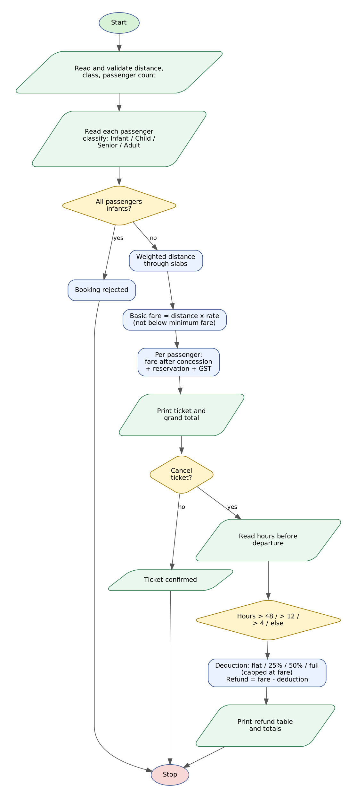

# Case Study 6: Railway Fare and Reservation Calculator

> Python Activity-Based Learning - case study **#6** from the given list of 100.


## 1. Problem Statement

When a family books train tickets, the price depends on many rules at once: the **distance travelled**, the **class of travel**, the **age and gender of each passenger** (children and senior citizens get concessions, infants travel free), a **reservation fee**, GST on air-conditioned classes, and - if the plan changes - **cancellation charges** that grow as departure time comes closer.

Write a Python program that books a ticket for up to six passengers, prints an itemised fare for each of them, and can then calculate the refund if the ticket is cancelled a given number of hours before departure.

## 2. Objectives

- Use parallel lists as lookup tables for classes, rates, fees and charges.
- Calculate fares with distance slabs using a list of tuples and a weighted-distance loop.
- Classify passengers (infant, child, senior, adult) with nested conditions and apply concessions.
- Validate every input with loops until a correct value is entered.
- Apply a time-based cancellation policy and print an itemised refund.

## 3. Assumptions

- Classes: SL (Rs. 0.55/km), 3A (1.35), 2A (1.95), 1A (3.30) with minimum basic fares 120, 330, 480 and 800.
- Distance slabs: first 200 km counted fully, 201-500 km at 90%, 501-1000 km at 80%, beyond 1000 km at 70%.
- Age rules: below 5 = infant (free, no reservation); 5-11 = child (50% off); men 60+ get 40% off and women 58+ get 50% off; others pay full fare.
- Reservation fee: Rs. 20 / 40 / 50 / 60 per ticketed passenger. GST of 5% on the basic fare for AC classes only.
- Cancellation: more than 48 h - flat clearance charge (Rs. 120 / 180 / 200 / 240); 12-48 h - 25% of fare; 4-12 h - 50% of fare (both not less than the clearance charge); less than 4 h - no refund. Deduction never exceeds the fare.
- Reservation fee and GST are non-refundable. At most 6 passengers per booking and distance 1-3500 km.
- An infant cannot travel unless at least one ticketed passenger is present. All fares are hypothetical.

## 4. Algorithm

1. Read the train name; read and validate the distance, the travel class and the number of passengers (re-ask on invalid input).
2. For each passenger read `name,age,gender`, validate it and assign category and concession percentage.
3. If every passenger is an infant, reject the booking and stop.
4. Compute the effective (weighted) distance by walking through the distance slabs.
5. Basic fare = effective distance x class rate, but not below the class minimum fare.
6. For each passenger fare = basic fare x (100 - concession)/100; reservation fee (0 for infants); GST = fare x GST rate; total = sum of the three.
7. Print the itemised ticket and the grand total.
8. Ask whether to cancel. If yes, read the hours left and choose the cancellation rule.
9. For every ticketed passenger compute the deduction (capped at the fare) and refund = fare - deduction.
10. Print the refund table, total refund and the amount retained, then stop.

## 5. Flowchart



*(Graphviz source: [flowchart.dot](flowchart.dot))*

## 6. Pseudocode

```text
START
  CODES, RATE, MIN_FARE, RESERVE, CLEARANCE, GST  <- parallel lists (index = class)
  SLABS <- [(200,1.0), (500,0.9), (1000,0.8)];  LONG_WEIGHT <- 0.7
  READ train; READ distance (1-3500); READ class -> idx; READ count (1-6)   (validate each)
  FOR p <- 1 TO count
      READ "name,age,gender" until valid
      IF age < 5 THEN category <- Infant, concession <- 100
      ELSE IF age <= 11 THEN Child, 50
      ELSE IF gender = M AND age >= 60 THEN Senior, 40
      ELSE IF gender = F AND age >= 58 THEN Senior, 50
      ELSE Adult, 0
      ADD (name, age, gender, category, concession) TO people
  IF all passengers are Infant THEN PRINT "BOOKING REJECTED"
  ELSE
      eff <- 0; lower <- 0
      FOR EACH (upper, weight) IN SLABS
          IF distance > lower THEN eff <- eff + (MIN(distance, upper) - lower) * weight
          lower <- upper
      IF distance > lower THEN eff <- eff + (distance - lower) * LONG_WEIGHT
      base <- MAX(eff * RATE[idx], MIN_FARE[idx])
      FOR EACH passenger
          fare <- base * (100 - concession) / 100
          reserve <- 0 IF Infant ELSE RESERVE[idx]
          gst <- fare * GST[idx];  total <- fare + reserve + gst
      PRINT ticket and grand total
      READ cancel?
      IF cancel THEN
          READ hours
          FOR EACH ticketed passenger
              IF hours > 48 THEN ded <- CLEARANCE[idx]
              ELSE IF hours > 12 THEN ded <- MAX(25% of fare, CLEARANCE[idx])
              ELSE IF hours > 4 THEN ded <- MAX(50% of fare, CLEARANCE[idx])
              ELSE ded <- fare
              ded <- MIN(ded, fare);  refund <- fare - ded
          PRINT refund table, total refund, amount retained
END
```

## 7. Python Source Code

File: [`railway_fare.py`](railway_fare.py)

```python
# =====================================================================
# CS06 : Railway Fare and Reservation Calculator (with cancellation)
# Syllabus used : variables, data types, operators, conditionals,
#                 loops, strings, lists, tuples, unpacking
# =====================================================================

print("=" * 72)
print("          RAILWAY FARE, RESERVATION AND CANCELLATION SYSTEM")
print("=" * 72)

# ---------------- Fare tables (parallel lists, same index = same class) ----------------
CODES = ["SL", "3A", "2A", "1A"]
NAMES = ["Sleeper", "AC 3-Tier", "AC 2-Tier", "AC First"]
RATE = [0.55, 1.35, 1.95, 3.30]         # Rs per km (base)
MIN_FARE = [120, 330, 480, 800]         # minimum basic fare (Rs.)
RESERVE = [20, 40, 50, 60]              # reservation fee per passenger (Rs.)
CLEARANCE = [120, 180, 200, 240]        # cancellation clearance charge (Rs.)
GST = [0.0, 0.05, 0.05, 0.05]           # GST on basic fare
SLABS = [(200, 1.0), (500, 0.9), (1000, 0.8)]   # (upper km, weight of each km)
LONG_WEIGHT = 0.7                       # weight for km beyond 1000
MAX_PASSENGERS = 6

# ---------------- Journey details ----------------
train = input("Train name : ").strip()

text = input("Distance in km (1-3500) : ")
while not text.isdigit() or int(text) < 1 or int(text) > 3500:
    text = input("  Invalid distance. Enter 1-3500 : ")
distance = int(text)

idx = -1
while idx == -1:
    code = input("Travel class (SL / 3A / 2A / 1A) : ").strip().upper()
    for k in range(len(CODES)):
        if CODES[k] == code:
            idx = k
    if idx == -1:
        print("  Invalid class. Choose from SL, 3A, 2A, 1A.")

text = input("Number of passengers (1-" + str(MAX_PASSENGERS) + ") : ")
while not text.isdigit() or int(text) < 1 or int(text) > MAX_PASSENGERS:
    text = input("  Enter a number between 1 and " + str(MAX_PASSENGERS) + " : ")
count = int(text)

# ---------------- Passenger details ----------------
people = []     # tuples: (name, age, gender, category, concession_percent)
for p in range(count):
    ok = False
    while not ok:
        line = input("Passenger " + str(p + 1) + " (name,age,M/F) : ")
        parts = line.split(",")
        if len(parts) == 3:
            pname = parts[0].strip()
            page = parts[1].strip()
            pg = parts[2].strip().upper()
            if pname != "" and page.isdigit() and int(page) <= 120 and (pg == "M" or pg == "F"):
                ok = True
        if not ok:
            print("  Invalid passenger details. Please re-enter.")
    age = int(page)
    if age < 5:
        category = "Infant"
        concession = 100
    elif age <= 11:
        category = "Child"
        concession = 50
    elif pg == "M" and age >= 60:
        category = "Senior"
        concession = 40
    elif pg == "F" and age >= 58:
        category = "Senior"
        concession = 50
    else:
        category = "Adult"
        concession = 0
    people.append((pname, age, pg, category, concession))

# ---------------- Infants cannot travel alone ----------------
has_ticketed = False
for person in people:
    if person[3] != "Infant":
        has_ticketed = True

if not has_ticketed:
    print("\nBOOKING REJECTED : infants (below 5 years) cannot travel without an")
    print("accompanying passenger who holds a ticket.")
else:
    # ---------------- Basic fare using distance slabs ----------------
    eff = 0.0
    lower = 0
    for upper, weight in SLABS:
        if distance > lower:
            if distance < upper:
                seg = distance - lower
            else:
                seg = upper - lower
            eff += seg * weight
        lower = upper
    if distance > lower:
        eff += (distance - lower) * LONG_WEIGHT

    base = eff * RATE[idx]
    if base < MIN_FARE[idx]:
        base = MIN_FARE[idx]
    base = round(base, 2)

    # ---------------- Ticket ----------------
    print("\n" + "=" * 72)
    print("TICKET : " + train + "   |   " + str(distance) + " km   |   " + NAMES[idx])
    print("Full basic fare for one adult : Rs. " + f"{base:.2f}")
    print("=" * 72)
    print(f"{'Passenger':<12}{'Age':>4} {'Category':<8}{'Concn':>6}{'Fare':>9}"
          f"{'Reserve':>9}{'GST':>7}{'Total':>10}")
    print("-" * 72)

    tickets = []    # tuples: (name, category, fare, reserve, gst, total)
    grand = 0.0
    for person in people:
        pname, age, pg, category, concession = person
        fare = round(base * (100 - concession) / 100, 2)
        if category == "Infant":
            reserve = 0
        else:
            reserve = RESERVE[idx]
        gst = round(fare * GST[idx], 2)
        total = fare + reserve + gst
        grand += total
        tickets.append((pname, category, fare, reserve, gst, total))
        print(f"{pname:<12}{age:>4} {category:<8}{str(concession) + '%':>6}{fare:>9.2f}"
              f"{reserve:>9.2f}{gst:>7.2f}{total:>10.2f}")
    print("-" * 72)
    print(f"{'TOTAL AMOUNT PAYABLE':<48}{'Rs.':>6}{grand:>18.2f}")

    # ---------------- Cancellation ----------------
    choice = input("\nCancel this ticket? (y/n) : ").strip().lower()
    if choice == "y":
        text = input("Hours remaining before departure : ")
        while not text.isdigit():
            text = input("  Enter a whole number of hours : ")
        hours = int(text)

        if hours > 48:
            rule = "More than 48 h : flat clearance charge"
        elif hours > 12:
            rule = "12-48 h : 25% of fare (minimum clearance charge)"
        elif hours > 4:
            rule = "4-12 h : 50% of fare (minimum clearance charge)"
        else:
            rule = "Less than 4 h : NO refund"
        print("\nCANCELLATION RULE APPLIED : " + rule)
        print("-" * 72)
        print(f"{'Passenger':<12}{'Fare paid':>11}{'Deduction':>12}{'Refund':>10}")

        refund_total = 0.0
        for t in tickets:
            tname, tcat, fare, reserve, gst, total = t
            if tcat == "Infant":
                ded = 0.0
            elif hours > 48:
                ded = CLEARANCE[idx]
            elif hours > 12:
                ded = fare * 0.25
                if ded < CLEARANCE[idx]:
                    ded = CLEARANCE[idx]
            elif hours > 4:
                ded = fare * 0.50
                if ded < CLEARANCE[idx]:
                    ded = CLEARANCE[idx]
            else:
                ded = fare
            if ded > fare:
                ded = fare
            refund = fare - ded
            refund_total += refund
            print(f"{tname:<12}{fare:>11.2f}{ded:>12.2f}{refund:>10.2f}")
        print("-" * 72)
        print("Reservation fee and GST are non-refundable.")
        print("TOTAL REFUND : Rs. " + f"{refund_total:.2f}")
        print("AMOUNT RETAINED : Rs. " + f"{grand - refund_total:.2f}")
    else:
        print("Ticket confirmed. Have a safe journey!")
```

**How to run**

```bash
# interactive - type the inputs yourself
python railway_fare.py

# or replay a prepared test (Linux/macOS)
python railway_fare.py < tests/test1_input.txt

# Windows PowerShell
Get-Content tests\test1_input.txt | python railway_fare.py
```

## 8. Test Cases

Every test has an input file (`tests/testN_input.txt`) and the program's real output (`tests/testN_output.txt`). The expected results below were checked against the output.

| # | Scenario | Key expected results (checked automatically) | Input | Result |
|---|----------|-----------------------------------------------|-------|--------|
| T1 | **Family booking in AC 3-Tier: adult, child and infant**<br>650 km, four passengers. Child pays 50%, infant travels free without reservation. | `Full basic fare for one adult : Rs. 796.50`<br>`Infant`<br>`Child`<br>`Ticket confirmed`<br>`TOTAL AMOUNT PAYABLE` | [test1_input.txt](tests/test1_input.txt) | PASS |
| T2 | **Senior concession and cancellation 12-48 hours before departure**<br>400 km AC 3-Tier, woman aged 40 and man aged 61 (40% senior concession). Cancel 30 hours before. | `12-48 h`<br>`TOTAL REFUND : Rs. 460.80`<br>`Senior`<br>`non-refundable` | [test2_input.txt](tests/test2_input.txt) | PASS |
| T3 | **Validation of every input and cancellation under 4 hours**<br>Bad distance, class, passenger count and passenger record are rejected before a valid booking; no refund. | `Invalid distance`<br>`Invalid class`<br>`Enter a number between 1 and 6`<br>`Invalid passenger details`<br>`NO refund`<br>+ 1 more checks | [test3_input.txt](tests/test3_input.txt) | PASS |
| T4 | **Infant cannot travel alone**<br>A booking containing only an infant is rejected. | `BOOKING REJECTED`<br>`cannot travel without` | [test4_input.txt](tests/test4_input.txt) | PASS |
| T5 | **Cancellation more than 48 hours before departure**<br>100 km AC 2-Tier, one adult. Minimum fare Rs.480, flat clearance charge Rs.200, refund Rs.280. | `More than 48 h`<br>`TOTAL REFUND : Rs. 280.00`<br>`AMOUNT RETAINED` | [test5_input.txt](tests/test5_input.txt) | PASS |

<details><summary>Input typed in test T1</summary>

```text
Chennai Express
650
3A
4
Anil,34,M
Meena,32,F
Rohan,8,M
Baby,3,M
n
```
</details>

<details><summary>Input typed in test T2</summary>

```text
Rajdhani
400
3A
2
Anita,40,F
Ravi,61,M
y
30
```
</details>

<details><summary>Input typed in test T3</summary>

```text
Duronto
abc
0
5000
1200
XX
1a
7
2
Asha,29,F
Tom,x,M
Tom,30,M
y
2
```
</details>

<details><summary>Input typed in test T4</summary>

```text
Local Passenger
50
SL
1
Baby,2,F
```
</details>

<details><summary>Input typed in test T5</summary>

```text
Express
100
2A
1
Mohan,35,M
y
72
```
</details>

## 9. Output Screenshots

Typed input is shown in green.

**T1 - Family booking in AC 3-Tier: adult, child and infant**


**T2 - Senior concession and cancellation 12-48 hours before departure**


**T3 - Validation of every input and cancellation under 4 hours**


**T4 - Infant cannot travel alone**


**T5 - Cancellation more than 48 hours before departure**


## 10. Conclusion

The calculator handles the real complications of a rail booking in one program: slab distance, class tables, age-based concessions, reservation fee, GST and a four-level cancellation policy. Using parallel lists for the class tables kept the code short and made adding a new class a matter of appending one value to each list. All five test cases passed, including a family booking with an infant, a senior-citizen cancellation (refund Rs. 460.80), invalid inputs, an infant travelling alone (rejected) and a cancellation more than 48 hours ahead (refund Rs. 280.00).
