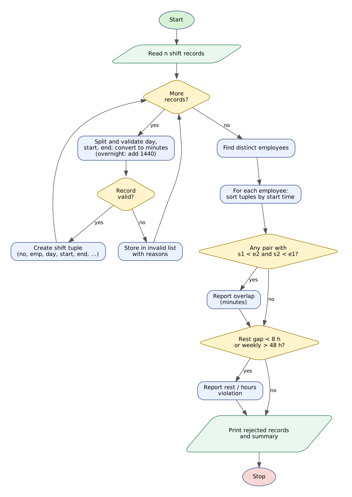

# Case Study 48: Tuple-Based Employee Shift Conflict Detection

> Python Activity-Based Learning - case study **#48** from the given list of 100.

## 1. Problem Statement

Hospitals, factories and call centres run on shift rosters. A manager who prepares the weekly roster by hand can accidentally book the same person in two places at once, schedule a night shift immediately after an evening shift or give someone more hours than the law allows. Such mistakes cause unsafe working conditions and last-minute shortages.

Write a Python program that reads shifts as `EmpID,Day,Start,End,Location`, converts each valid shift into a **tuple**, and then checks every employee for **overlapping shifts** (including night shifts that cross midnight), **insufficient rest** between consecutive shifts and **weekly hours above the limit**. Invalid records must be rejected with a reason.

## 2. Objectives

- Represent each shift as an immutable tuple and use tuple indexing, slicing, unpacking and comparison.
- Convert clock times to minutes and handle shifts that end after midnight.
- Detect overlaps between every pair of intervals with the condition `s1 < e2 and s2 < e1`.
- Sort each employee's tuples by start time and measure rest gaps between neighbours.
- Validate roster text and report conflicts per employee together with a summary.

## 3. Assumptions

- Days are Mon-Sun (names accepted in any case; only the first three letters are used). Times use 24-hour `HH:MM`.
- If the end time is earlier than the start time the shift continues into the next day (overnight shift).
- Time is measured in minutes from Monday 00:00; a shift that runs beyond Sunday midnight is not wrapped to Monday.
- A single shift may not be longer than 12 hours and may not have zero length.
- Minimum rest between two consecutive shifts of the same employee is 8 hours; weekly limit is 48 hours.
- Overlap is reported even if the two shifts are at different locations (one person cannot be in two places).
- Employee IDs and locations are free text; data is hypothetical.

## 4. Algorithm

1. Read the number of shift records `n`.
2. For each record split on commas, check that there are five fields and validate day, start time and end time.
3. Convert times to minutes; if the end is earlier add 1440 to make an overnight shift; reject zero-length and over-12-hour shifts.
4. Valid shift: compute `abs_start = day*1440 + start`, `abs_end = abs_start + length`, build a description and store the tuple `(no, emp, day, abs_start, abs_end, location, description)`.
5. Invalid shift: store the record with the list of reasons.
6. Collect the list of distinct employees.
7. For each employee gather their tuples and bubble-sort them by `abs_start`.
8. For every pair `a < b` unpack the interval with slicing `rec[3:5]`; if `s1 < e2 and s2 < e1` report an overlap of `min(e1,e2) - max(s1,s2)` minutes.
9. For consecutive shifts with `gap = next_start - prev_end` between 0 and 480 minutes report a rest violation; report weekly hours above 48.
10. Print rejected records and the summary (valid, rejected, overlaps, rest violations, employees in conflict).

## 5. Flowchart



*(Graphviz source: [flowchart.dot](flowchart.dot))*

## 6. Pseudocode

```text
START
  DAYS <- [Mon..Sun]; MIN_REST <- 480; MAX_SHIFT <- 720; WEEKLY_LIMIT <- 2880
  READ n; shifts <- [ ]; invalid <- [ ]
  FOR i <- 1 TO n
      READ line; fields <- SPLIT(line, ",")
      reasons <- [ ]
      IF COUNT(fields) != 5 THEN ADD reason
      ELSE
          day <- INDEX of first 3 letters in DAYS   (or -1 -> reason)
          sm <- minutes of start "HH:MM"             (or invalid -> reason)
          em <- minutes of end   "HH:MM"             (or invalid -> reason)
          IF sm and em valid THEN
              IF em = sm THEN ADD "zero-length"
              ELSE length <- em - sm; IF length < 0 THEN length <- length + 1440
                   IF length > MAX_SHIFT THEN ADD "longer than 12 hours"
      IF reasons is empty THEN
          abs_start <- day * 1440 + sm;  abs_end <- abs_start + length
          ADD TUPLE (i, emp, day, abs_start, abs_end, location, description) TO shifts
      ELSE ADD (i, line, reasons) TO invalid
  emps <- distinct employee IDs
  FOR EACH emp IN emps
      mine <- tuples of emp; BUBBLE-SORT mine by abs_start
      minutes <- SUM(abs_end - abs_start)
      FOR a <- 1 TO COUNT(mine); FOR b <- a+1 TO COUNT(mine)
          (s1, e1) <- mine[a][3:5];  (s2, e2) <- mine[b][3:5]
          IF s1 < e2 AND s2 < e1 THEN REPORT overlap of MIN(e1,e2) - MAX(s1,s2) minutes
      FOR a <- 1 TO COUNT(mine) - 1
          gap <- mine[a+1].start - mine[a].end
          IF 0 <= gap < MIN_REST THEN REPORT rest violation
      IF minutes > WEEKLY_LIMIT THEN REPORT hours violation
  PRINT rejected records and summary
END
```

## 7. Python Source Code

File: [`shift_conflicts.py`](shift_conflicts.py)

```python
# =====================================================================
# CS48 : Tuple-Based Employee Shift Conflict Detection
# Syllabus used : variables, data types, operators, conditionals,
#                 loops, strings, lists, tuples, tuple slicing,
#                 tuple unpacking, tuple comparison
# =====================================================================

print("=" * 74)
print("          EMPLOYEE SHIFT CONFLICT DETECTION (HOSPITAL ROSTER)")
print("=" * 74)

DAYS = ["Mon", "Tue", "Wed", "Thu", "Fri", "Sat", "Sun"]
MIN_REST = 8 * 60          # minimum rest between two shifts (minutes)
MAX_SHIFT = 12 * 60        # longest allowed single shift (minutes)
WEEKLY_LIMIT = 48 * 60     # weekly working-time limit (minutes)

print("Record format : EmpID,Day,Start,End,Location   e.g. E01,Mon,09:00,17:00,Ward A")
text = input("Number of shift records : ")
while not text.isdigit() or int(text) == 0:
    text = input("  Enter a positive whole number : ")
n = int(text)

shifts = []     # tuples: (no, emp, day, abs_start, abs_end, location, description)
invalid = []    # tuples: (no, text, [reasons])

# ---------------- Read, validate and convert every record ----------------
for i in range(n):
    line = input("Shift " + str(i + 1) + " : ")
    parts = line.split(",")
    reasons = []
    if len(parts) != 5:
        reasons.append("5 comma-separated fields are required (found " + str(len(parts)) + ")")
    else:
        emp = parts[0].strip()
        dtext = parts[1].strip().capitalize()[0:3]
        st = parts[2].strip()
        en = parts[3].strip()
        loc = parts[4].strip()

        day = -1
        for k in range(7):
            if DAYS[k] == dtext:
                day = k
        if emp == "":
            reasons.append("employee ID is missing")
        if day == -1:
            reasons.append("invalid day '" + parts[1].strip() + "'")

        sm = -1
        sp = st.split(":")
        if len(sp) == 2 and sp[0].isdigit() and sp[1].isdigit() and int(sp[0]) < 24 and int(sp[1]) < 60:
            sm = int(sp[0]) * 60 + int(sp[1])
        else:
            reasons.append("invalid start time '" + st + "'")

        em = -1
        ep = en.split(":")
        if len(ep) == 2 and ep[0].isdigit() and ep[1].isdigit() and int(ep[0]) < 24 and int(ep[1]) < 60:
            em = int(ep[0]) * 60 + int(ep[1])
        else:
            reasons.append("invalid end time '" + en + "'")

        length = 0
        if sm != -1 and em != -1:
            if em == sm:
                reasons.append("zero-length shift")
            else:
                length = em - sm
                if length < 0:
                    length += 1440          # overnight shift crosses midnight
                if length > MAX_SHIFT:
                    reasons.append("shift of " + str(length // 60) + "h " + str(length % 60) +
                                   "m exceeds the 12-hour maximum")

        if len(reasons) == 0:
            abs_start = day * 1440 + sm      # minutes since Monday 00:00
            abs_end = abs_start + length
            end_txt = f"{(abs_end % 1440) // 60:02d}:{abs_end % 60:02d}"
            if abs_end // 1440 > abs_start // 1440:
                end_txt += "(+1)"
            desc = DAYS[day] + " " + f"{sm // 60:02d}:{sm % 60:02d}" + "-" + end_txt + " @" + loc
            shifts.append((i + 1, emp, day, abs_start, abs_end, loc, desc))
    if len(reasons) > 0:
        invalid.append((i + 1, line.strip(), reasons))

# ---------------- Unique employees ----------------
emps = []
for rec in shifts:
    if rec[1] not in emps:
        emps.append(rec[1])

# ---------------- Analyse each employee ----------------
overlap_total = 0
rest_total = 0
problem_emps = []

print("\n" + "=" * 74)
print("CONFLICT REPORT")
print("=" * 74)
for emp in emps:
    mine = []
    for rec in shifts:
        if rec[1] == emp:
            mine.append(rec)

    # sort this employee's tuples by start time (bubble sort)
    for a in range(len(mine) - 1):
        for b in range(len(mine) - 1 - a):
            if mine[b][3] > mine[b + 1][3]:
                mine[b], mine[b + 1] = mine[b + 1], mine[b]

    minutes = 0
    for rec in mine:
        no, e, d, s, en, loc, desc = rec          # tuple unpacking
        minutes += en - s

    print("\nEmployee " + emp + "  (" + str(len(mine)) + " shift(s), " +
          f"{minutes / 60:.1f}" + " h this week)")
    for rec in mine:
        print("   Shift #" + str(rec[0]) + "  " + rec[6])

    problems = 0
    # overlap check: every pair of shifts of the same employee
    for a in range(len(mine)):
        for b in range(a + 1, len(mine)):
            s1, e1 = mine[a][3:5]                 # tuple slicing + unpacking
            s2, e2 = mine[b][3:5]
            if s1 < e2 and s2 < e1:
                lo = s1
                if s2 > lo:
                    lo = s2
                hi = e1
                if e2 < hi:
                    hi = e2
                print("   [OVERLAP] Shift #" + str(mine[a][0]) + " and Shift #" + str(mine[b][0]) +
                      " clash for " + str(hi - lo) + " minutes")
                overlap_total += 1
                problems += 1

    # rest check: gap between consecutive, non-overlapping shifts
    for a in range(len(mine) - 1):
        gap = mine[a + 1][3] - mine[a][4]
        if gap >= 0 and gap < MIN_REST:
            print("   [REST]    Only " + str(gap // 60) + "h " + str(gap % 60) + "m between Shift #" +
                  str(mine[a][0]) + " and Shift #" + str(mine[a + 1][0]) +
                  " (minimum 8h)")
            rest_total += 1
            problems += 1

    if minutes > WEEKLY_LIMIT:
        print("   [HOURS]   Weekly total exceeds 48 hours")
        problems += 1

    if problems == 0:
        print("   OK - no conflicts")
    else:
        problem_emps.append(emp)

# ---------------- Invalid records ----------------
print("\n" + "=" * 74)
print("REJECTED RECORDS")
print("=" * 74)
if len(invalid) == 0:
    print("None")
else:
    for item in invalid:
        num, original, why = item
        print("Record " + str(num) + " : " + original)
        for w in why:
            print("   - " + w)

# ---------------- Summary ----------------
print("\nSUMMARY")
print("-" * 74)
print("Records read        : " + str(n))
print("Valid shifts        : " + str(len(shifts)))
print("Rejected records    : " + str(len(invalid)))
print("Overlap conflicts   : " + str(overlap_total))
print("Rest-gap violations : " + str(rest_total))
if len(problem_emps) == 0:
    print("Employees in conflict : None")
else:
    print("Employees in conflict : " + ", ".join(problem_emps))
```

**How to run**

```bash
# interactive - type the inputs yourself
python shift_conflicts.py

# or replay a prepared test (Linux/macOS)
python shift_conflicts.py < tests/test1_input.txt

# Windows PowerShell
Get-Content tests\test1_input.txt | python shift_conflicts.py
```

## 8. Test Cases

Every test has an input file (`tests/testN_input.txt`) and the program's real output (`tests/testN_output.txt`). The expected results below were checked against the output.

| # | Scenario | Key expected results (checked automatically) | Input | Result |
|---|----------|-----------------------------------------------|-------|--------|
| T1 | **Hospital roster with overlaps, an overnight clash and a short rest gap**<br>E01 overlaps by 2 h, E02 (overnight shift) overlaps by 1 h, E03 has only 4 h rest, E04 is clean. | `[OVERLAP] Shift #1 and Shift #2 clash for 120 minutes`<br>`[OVERLAP] Shift #3 and Shift #4 clash for 60 minutes`<br>`Only 4h 0m between Shift #5 and Shift #6`<br>`Overlap conflicts   : 2`<br>`Rest-gap violations : 1`<br>+ 3 more checks | [test1_input.txt](tests/test1_input.txt) | PASS |
| T2 | **Every kind of invalid record is rejected with a reason**<br>Bad day, bad hour, zero-length shift, 14-hour shift, '9am' time and a record with a missing field. | `invalid day 'Funday'`<br>`invalid start time '25:00'`<br>`zero-length shift`<br>`exceeds the 12-hour maximum`<br>`invalid start time '9am'`<br>+ 3 more checks | [test2_input.txt](tests/test2_input.txt) | PASS |
| T3 | **Clean roster with overnight shifts**<br>Night shifts crossing midnight and day shifts with healthy rest; no conflicts are reported. | `Overlap conflicts   : 0`<br>`Rest-gap violations : 0`<br>`Employees in conflict : None`<br>`(+1)` | [test3_input.txt](tests/test3_input.txt) | PASS |
| T4 | **Weekly working-time limit exceeded**<br>Five 10-hour shifts give 50 hours, above the 48-hour limit. | `[HOURS]   Weekly total exceeds 48 hours`<br>`Employees in conflict : H01`<br>`50.0 h this week` | [test4_input.txt](tests/test4_input.txt) | PASS |

<details><summary>Input typed in test T1</summary>

```text
8
E01,Mon,09:00,17:00,Ward A
E01,Mon,15:00,23:00,ER
E02,Mon,22:00,06:00,ICU
E02,Tue,05:00,13:00,ICU
E03,Wed,08:00,16:00,Ward B
E03,Wed,20:00,23:30,Ward B
E03,Thu,08:00,16:00,Ward B
E04,Fri,10:00,18:00,Lab
```
</details>

<details><summary>Input typed in test T2</summary>

```text
6
E05,Funday,09:00,17:00,Lab
E05,Mon,25:00,17:00,Lab
E05,Mon,09:00,09:00,Lab
E05,Mon,06:00,20:00,Lab
E05,Mon,9am,17:00,Lab
E06,Sat,09:00,13:00
```
</details>

<details><summary>Input typed in test T3</summary>

```text
5
N01,Mon,22:00,06:00,ICU
N01,Wed,22:00,06:00,ICU
N02,Tue,08:00,16:00,Lab
N02,Wed,08:00,16:00,Lab
N02,Thu,08:00,16:00,Lab
```
</details>

<details><summary>Input typed in test T4</summary>

```text
5
H01,Mon,08:00,18:00,A
H01,Tue,08:00,18:00,A
H01,Wed,08:00,18:00,A
H01,Thu,08:00,18:00,A
H01,Fri,08:00,18:00,A
```
</details>

## 9. Output Screenshots

Typed input is shown in green.

**T1 - Hospital roster with overlaps, an overnight clash and a short rest gap**


**T2 - Every kind of invalid record is rejected with a reason**


**T3 - Clean roster with overnight shifts**


**T4 - Weekly working-time limit exceeded**


## 10. Conclusion

Tuples were a natural fit for shifts: each record is fixed once created, and slicing `rec[3:5]` gives the time interval directly for comparison. The program found the three kinds of roster problems that matter in practice - a two-hour overlap, a one-hour overlap caused by an overnight shift crossing midnight, and a rest gap of only four hours - and reported that the roster of E04 was clean. Invalid records were rejected with explicit reasons instead of silently corrupting the analysis. All four test cases passed.
