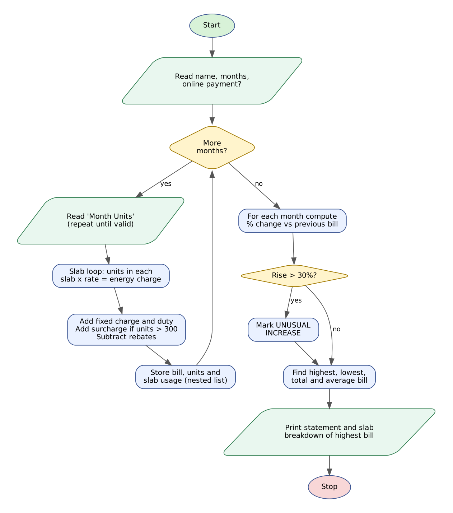

# Case Study 2: Progressive Electricity Billing

> Python Activity-Based Learning - case study **#2** from the given list of 100.


## 1. Problem Statement

A household electricity bill is not a single price per unit. The distribution company charges **progressively higher rates** as consumption grows, adds a fixed monthly charge and electricity duty, applies a **surcharge** on heavy usage and gives **rebates** to small consumers and to customers who pay online. A family receives a new bill every month and often notices only when a bill suddenly becomes very large.

Write a Python program that calculates the bill for several months using the slab tariff, shows how each bill is made up, compares every month with the previous one and **flags unusual increases** so the consumer can investigate (for example a faulty appliance).

## 2. Objectives

- Implement a multi-slab progressive tariff using a list of tuples and tuple unpacking in a loop.
- Add fixed charges, duty and surcharge and subtract rebates using conditional statements.
- Store monthly data in lists and slab-wise usage in a nested list.
- Calculate month-to-month percentage change and detect unusual increases.
- Report totals, average, highest and lowest bills and a slab breakdown of the highest bill.

## 3. Assumptions

- Tariff per unit: 1-100 Rs. 3.50, 101-200 Rs. 5.00, 201-400 Rs. 6.50, above 400 Rs. 8.00.
- Fixed charge Rs. 120 per month; electricity duty 5% of the energy charge.
- Surcharge of 10% of the energy charge applies when a month's consumption is above 300 units.
- Consumers using 100 units or fewer get a 10% rebate on the energy charge; online payment gives a flat Rs. 25 rebate.
- A bill that rises by **more than 30%** over the previous month is called an unusual increase.
- Between 2 and 12 months are analysed; each month is entered as `MonthName Units` with whole units.
- All amounts are in rupees and shown rounded to two decimals; the data is hypothetical.

## 4. Algorithm

1. Read the consumer name, the number of months (2-12) and whether payment is online.
2. For each month read `MonthName Units`; repeat the question until the entry is valid.
3. Walk through the slab list `(upper limit, rate)`. For every slab that the consumption reaches, take the units that fall inside it, multiply by the rate and add to the energy charge; remember the units per slab in a list.
4. Add the units above the last slab at the top rate.
5. Calculate duty (5%), surcharge (10% if units > 300) and rebates (10% if units <= 100, Rs. 25 if online).
6. Bill = energy + fixed charge + duty + surcharge - rebates. Store the row and the slab list.
7. After all months are entered print the statement; for every month except the first compute the percentage change in units and in bill.
8. If the bill change is above 30% mark the month as UNUSUAL INCREASE.
9. Find the highest and lowest bill, the total and the average and print them.
10. Print the slab-wise breakdown of the highest bill and stop.

## 5. Flowchart



*(Graphviz source: [flowchart.dot](flowchart.dot))*

## 6. Pseudocode

```text
START
  SLABS <- [(100, 3.50), (200, 5.00), (400, 6.50)];  TOP_RATE <- 8.00
  FIXED <- 120; DUTY <- 5%; SURCHARGE <- 10% above 300 units
  READ consumer, months, online?
  FOR i <- 1 TO months
      READ "Month Units"  (repeat until valid)
      used <- [0,0,0,0]; energy <- 0; lower <- 0; s <- 0
      FOR EACH (upper, rate) IN SLABS
          IF units > lower THEN
              part <- MIN(units, upper) - lower
              used[s] <- part; energy <- energy + part * rate
          lower <- upper; s <- s + 1
      IF units > lower THEN used[3] <- units - lower; energy <- energy + used[3] * TOP_RATE
      duty <- energy * 0.05
      IF units > 300 THEN surcharge <- energy * 0.10 ELSE surcharge <- 0
      rebate <- 0
      IF units <= 100 THEN rebate <- rebate + energy * 0.10
      IF online THEN rebate <- rebate + 25
      bill <- energy + FIXED + duty + surcharge - rebate
      STORE month, units, bill, used (nested list)
  END FOR
  FOR i <- 1 TO months
      IF i > 1 THEN
          change <- (bill[i] - bill[i-1]) * 100 / bill[i-1]
          IF change > 30 THEN FLAG "UNUSUAL INCREASE"
      PRINT row
  FIND highest and lowest bill; PRINT total, average
  PRINT slab breakdown of highest bill
END
```

## 7. Python Source Code

File: [`electricity_billing.py`](electricity_billing.py)

```python
# =====================================================================
# CS02 : Progressive Electricity Billing with Anomaly Detection
# Syllabus used : variables, data types, operators, conditionals,
#                 loops, strings, lists, nested lists, tuples, unpacking
# =====================================================================

print("=" * 80)
print("         PROGRESSIVE ELECTRICITY BILLING AND ANOMALY DETECTION")
print("=" * 80)

# ---------------- Tariff (constants) ----------------
SLABS = [(100, 3.50), (200, 5.00), (400, 6.50)]   # (upper limit in units, Rs/unit)
TOP_RATE = 8.00             # Rs/unit above the last slab limit
SLAB_LABELS = ["1-100", "101-200", "201-400", "Above 400"]
SLAB_RATES = [3.50, 5.00, 6.50, 8.00]
FIXED = 120.00              # fixed monthly charge (Rs.)
DUTY_RATE = 0.05            # electricity duty on energy charge
SURCHARGE_LIMIT = 300       # surcharge applies above this many units
SURCHARGE_RATE = 0.10       # surcharge on energy charge
LIFELINE_LIMIT = 100        # small consumers: units <= this get rebate
LIFELINE_REBATE = 0.10      # 10% rebate on energy charge
ONLINE_REBATE = 25.00       # flat rebate for online payment
UNUSUAL_RISE = 30.0         # bill increase (%) treated as unusual

# ---------------- Input ----------------
consumer = input("Consumer name : ").strip()
text = input("Number of months to analyse (2-12) : ")
while not text.isdigit() or int(text) < 2 or int(text) > 12:
    text = input("  Enter a number between 2 and 12 : ")
months = int(text)
pay = input("Pay online? (y/n) : ").strip().lower()
online = (pay == "y")

month_names = []
units_list = []
bills = []
rows = []        # tuples: (month, units, energy, duty, surcharge, rebate, bill)
details = []     # nested list: units used in each of the 4 slabs, per month

for i in range(months):
    ok = False
    while not ok:
        line = input("Month " + str(i + 1) + " (e.g. Jan 240) : ")
        parts = line.split()
        if len(parts) == 2 and parts[0].isalpha() and parts[1].isdigit():
            ok = True
        else:
            print("  Invalid entry. Use the format: MonthName Units")
    mname = parts[0].capitalize()[0:3]
    units = int(parts[1])

    # ---- progressive slab calculation ----
    used = [0, 0, 0, 0]
    energy = 0.0
    lower = 0
    slab_no = 0
    for upper, rate in SLABS:
        if units > lower:
            if units < upper:
                part = units - lower
            else:
                part = upper - lower
            used[slab_no] = part
            energy += part * rate
        lower = upper
        slab_no += 1
    if units > lower:
        used[3] = units - lower
        energy += used[3] * TOP_RATE

    duty = energy * DUTY_RATE
    surcharge = 0.0
    if units > SURCHARGE_LIMIT:
        surcharge = energy * SURCHARGE_RATE
    rebate = 0.0
    if units <= LIFELINE_LIMIT:
        rebate += energy * LIFELINE_REBATE
    if online:
        rebate += ONLINE_REBATE
    bill = energy + FIXED + duty + surcharge - rebate

    month_names.append(mname)
    units_list.append(units)
    bills.append(bill)
    details.append(used)
    rows.append((mname, units, energy, duty, surcharge, rebate, bill))

# ---------------- Month-wise bill statement ----------------
print("\nCONSUMER : " + consumer)
print("=" * 80)
print(f"{'Month':<6}{'Units':>6}{'Energy':>10}{'Duty':>8}{'Surchg':>9}{'Rebate':>8}"
      f"{'Bill':>10}{'Units%':>8}{'Bill%':>8}  Flag")
print("-" * 80)
unusual_months = []
for i in range(months):
    mname, units, energy, duty, surcharge, rebate, bill = rows[i]
    units_chg = "-"
    bill_chg = "-"
    flag = ""
    if i > 0:
        prev_units = rows[i - 1][1]
        prev_bill = rows[i - 1][6]
        if prev_units > 0:
            units_chg = f"{(units - prev_units) * 100 / prev_units:+.1f}"
        change = (bill - prev_bill) * 100 / prev_bill
        bill_chg = f"{change:+.1f}"
        if change > UNUSUAL_RISE:
            flag = "<< UNUSUAL INCREASE"
            unusual_months.append(mname)
    print(f"{mname:<6}{units:>6}{energy:>10.2f}{duty:>8.2f}{surcharge:>9.2f}"
          f"{rebate:>8.2f}{bill:>10.2f}{units_chg:>8}{bill_chg:>8}  {flag}")
print("-" * 80)

# ---------------- Statistics ----------------
total_bill = 0.0
total_units = 0
high = 0
low = 0
for i in range(months):
    total_bill += bills[i]
    total_units += units_list[i]
    if bills[i] > bills[high]:
        high = i
    if bills[i] < bills[low]:
        low = i

print("Total units consumed : " + str(total_units))
print("Total amount payable : Rs. " + f"{total_bill:.2f}")
print("Average monthly bill : Rs. " + f"{total_bill / months:.2f}")
print("Highest bill         : " + month_names[high] + "  Rs. " + f"{bills[high]:.2f}")
print("Lowest bill          : " + month_names[low] + "  Rs. " + f"{bills[low]:.2f}")

if len(unusual_months) == 0:
    print("Unusual increases    : None (no month rose by more than "
          + str(int(UNUSUAL_RISE)) + "%)")
else:
    print("Unusual increases    : " + ", ".join(unusual_months) +
          " (bill rose by more than " + str(int(UNUSUAL_RISE)) + "%)")

# ---------------- Slab breakdown of the highest bill ----------------
print("\nSLAB BREAKDOWN OF HIGHEST BILL (" + month_names[high] + ")")
print("-" * 50)
for s in range(4):
    u = details[high][s]
    print(f"{SLAB_LABELS[s]:<12}{u:>5} units x Rs.{SLAB_RATES[s]:.2f} = Rs.{u * SLAB_RATES[s]:>9.2f}")
```

**How to run**

```bash
# interactive - type the inputs yourself
python electricity_billing.py

# or replay a prepared test (Linux/macOS)
python electricity_billing.py < tests/test1_input.txt

# Windows PowerShell
Get-Content tests\test1_input.txt | python electricity_billing.py
```

## 8. Test Cases

Every test has an input file (`tests/testN_input.txt`) and the program's real output (`tests/testN_output.txt`). The expected results below were checked against the output.

| # | Scenario | Key expected results (checked automatically) | Input | Result |
|---|----------|-----------------------------------------------|-------|--------|
| T1 | **Six-month history with sudden jumps (online payment)**<br>Usage 95, 110, 150, 380, 420, 130 units. March and April bills rise by more than 30%. | `Total units consumed : 1285`<br>`Unusual increases    : Mar, Apr`<br>`Highest bill         : May  Rs. 2751.50`<br>`<< UNUSUAL INCREASE`<br>`Above 400` | [test1_input.txt](tests/test1_input.txt) | PASS |
| T2 | **Stable consumption, no unusual increase**<br>Three months around 200 units without online rebate. | `Unusual increases    : None`<br>`Total units consumed : 615`<br>`SLAB BREAKDOWN` | [test2_input.txt](tests/test2_input.txt) | PASS |
| T3 | **Input validation and the low-consumer rebate**<br>Invalid month count and invalid month lines are rejected; 100 units earns the 10% lifeline rebate. | `Enter a number between 2 and 12`<br>`Invalid entry`<br>`Unusual increases    : None`<br>`Total units consumed : 200` | [test3_input.txt](tests/test3_input.txt) | PASS |

<details><summary>Input typed in test T1</summary>

```text
Ramesh
6
y
Jan 95
Feb 110
Mar 150
Apr 380
May 420
Jun 130
```
</details>

<details><summary>Input typed in test T2</summary>

```text
Priya
3
n
Jul 200
Aug 210
Sep 205
```
</details>

<details><summary>Input typed in test T3</summary>

```text
Test User
1
abc
2
n
Jan
Jan 100
Feb 5x
Feb 100
```
</details>

## 9. Output Screenshots

Typed input is shown in green.

**T1 - Six-month history with sudden jumps (online payment)**


**T2 - Stable consumption, no unusual increase**


**T3 - Input validation and the low-consumer rebate**


## 10. Conclusion

The program reproduces a real slab-based bill, including surcharge and rebates, and shows the consumer exactly where the money goes. Keeping the slabs as a list of `(limit, rate)` tuples means the tariff can be changed in one place without touching the logic. In the main test (95 to 420 units) the program correctly flagged March and April as unusual increases and reported May as the highest bill (Rs. 2751.50), while a stable three-month history produced no warnings.
