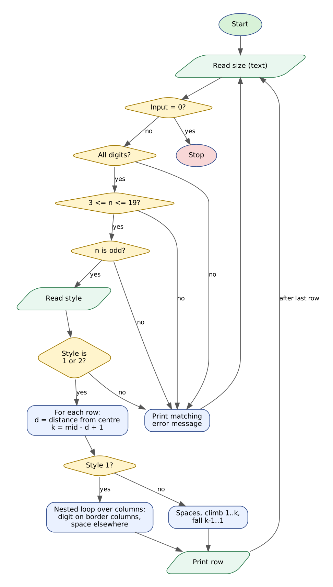

# Case Study 27: Advanced Numeric Pattern Generator

> Python Activity-Based Learning - case study **#27** from the given list of 100.


## 1. Problem Statement

Pattern programs train the skill of controlling *rows* and *columns* with nested loops, which is the same skill needed to print tables, calendars, seating charts and reports. In this case study a user asks for a **numeric diamond of a chosen size**. The program must offer two styles - a **hollow diamond**, where digits appear only on the border of the shape, and a **filled palindromic diamond**, where every row reads 1, 2, ..., k, ..., 2, 1 - and must keep the output **perfectly aligned** for every allowed size.

Invalid requests (letters, negative numbers, even sizes, sizes outside the supported range, unknown styles) must be rejected with a clear message and the user asked again.

## 2. Objectives

- Use nested `for` loops (rows x columns) to place characters in exact positions.
- Use `while` loops to build palindromic digit sequences inside a row.
- Validate input with string methods and conditions before any pattern is drawn.
- Handle digit overflow so that sizes above 17 still produce single-character columns.
- Run repeatedly in a menu-style loop until the user enters 0.

## 3. Assumptions

- Allowed sizes: **odd** numbers from 3 to 19 (even sizes cannot be symmetric about a centre row).
- Row *r* has the distance `d` from the centre row; its digit is `(centre - d + 1)`.
- Digits above 9 wrap around using modulo 10 (so 10 prints as 0) to keep one character per column.
- Style 1 = hollow diamond, style 2 = filled palindromic diamond. Trailing spaces are removed from every printed line.
- Input `0` ends the program.

## 4. Algorithm

1. Print the title and start a loop that runs until the user enters 0.
2. Read the size as a string. If it is `0` stop; if it is not all digits show an error and repeat.
3. Convert to an integer. If it is outside 3-19 or even, show the matching error and repeat.
4. Read the style; if it is not `1` or `2` show an error and repeat.
5. Calculate the centre row `mid = n // 2`.
6. For every row `0 ... n-1` find the distance `d` from the centre and the digit value `k = mid - d + 1`.
7. Style 1: for every column `0 ... n-1` print `k mod 10` if the column is `d` or `n-1-d`, otherwise a space.
8. Style 2: print `d` spaces, then climb 1 to k, then fall k-1 to 1 (each value taken modulo 10).
9. Print the row without trailing spaces. After the last row return to the size prompt.

## 5. Flowchart



*(Graphviz source: [flowchart.dot](flowchart.dot))*

## 6. Pseudocode

```text
START
  MIN <- 3; MAX <- 19; running <- TRUE
  WHILE running
      READ text
      IF text = "0" THEN PRINT "Goodbye"; running <- FALSE
      ELSE IF text is not all digits THEN PRINT error
      ELSE
          n <- INTEGER(text)
          IF n < MIN OR n > MAX THEN PRINT range error
          ELSE IF n is even THEN PRINT even-size error
          ELSE
              READ style
              IF style is not "1" and not "2" THEN PRINT style error
              ELSE
                  mid <- n DIV 2
                  FOR row <- 0 TO n-1
                      d <- ABS(mid - row);  k <- mid - d + 1;  line <- ""
                      IF style = "1" THEN
                          FOR col <- 0 TO n-1
                              IF col = d OR col = n-1-d THEN line <- line + (k MOD 10)
                              ELSE line <- line + " "
                      ELSE
                          line <- d spaces
                          FOR up <- 1 TO k:    line <- line + (up MOD 10)
                          FOR down <- k-1 TO 1: line <- line + (down MOD 10)
                      PRINT line without trailing spaces
END
```

## 7. Python Source Code

File: [`numeric_diamond.py`](numeric_diamond.py)

```python
# =====================================================================
# CS27 : Advanced Numeric Pattern Generator (hollow / filled diamond)
# Syllabus used : variables, operators, conditionals, loops,
#                 nested loops, strings, pattern generation
# =====================================================================

print("=" * 50)
print("       NUMERIC DIAMOND PATTERN GENERATOR")
print("=" * 50)

MIN_SIZE = 3
MAX_SIZE = 19

running = True
while running:
    text = input("\nEnter diamond size (odd, " + str(MIN_SIZE) + "-" + str(MAX_SIZE) +
                 "), or 0 to quit : ").strip()

    # ---------------- Validation ----------------
    if text == "0":
        print("Thank you. Goodbye!")
        running = False
    elif not text.isdigit():
        print("Invalid input: please enter digits only (no letters, signs or decimals).")
    else:
        n = int(text)
        if n < MIN_SIZE or n > MAX_SIZE:
            print("Invalid size: must be between " + str(MIN_SIZE) + " and " + str(MAX_SIZE) + ".")
        elif n % 2 == 0:
            print("Invalid size: " + str(n) + " is even. A symmetric diamond needs an odd size.")
        else:
            style = input("Style  1 = Hollow diamond   2 = Filled palindromic diamond : ").strip()
            if style != "1" and style != "2":
                print("Invalid style: choose 1 or 2.")
            else:
                mid = n // 2
                print()
                # ---------------- Pattern generation ----------------
                for row in range(n):
                    if row < mid:
                        d = mid - row          # distance of this row from the centre row
                    else:
                        d = row - mid
                    k = mid - d + 1            # width index of this row (1 at the tips)
                    line = ""

                    if style == "1":
                        # hollow: only the two border columns carry a digit
                        for col in range(n):
                            if col == d or col == n - 1 - d:
                                line += str(k % 10)
                            else:
                                line += " "
                    else:
                        # filled: digits climb 1..k then fall k-1..1 (palindrome)
                        line = " " * d
                        up = 1
                        while up <= k:
                            line += str(up % 10)
                            up += 1
                        down = k - 1
                        while down >= 1:
                            line += str(down % 10)
                            down -= 1

                    print(line.rstrip())
```

**How to run**

```bash
# interactive - type the inputs yourself
python numeric_diamond.py

# or replay a prepared test (Linux/macOS)
python numeric_diamond.py < tests/test1_input.txt

# Windows PowerShell
Get-Content tests\test1_input.txt | python numeric_diamond.py
```

## 8. Test Cases

Every test has an input file (`tests/testN_input.txt`) and the program's real output (`tests/testN_output.txt`). The expected results below were checked against the output.

| # | Scenario | Key expected results (checked automatically) | Input | Result |
|---|----------|-----------------------------------------------|-------|--------|
| T1 | **Hollow diamond of size 7**<br>Digits appear only on the two borders of each row and rise to the centre row. | pattern rows (see screenshot) starting `1`<br>`Goodbye` | [test1_input.txt](tests/test1_input.txt) | PASS |
| T2 | **Filled palindromic diamond of size 5**<br>Each row climbs 1..k and falls back to 1. | pattern rows (see screenshot) starting `1` | [test2_input.txt](tests/test2_input.txt) | PASS |
| T3 | **Invalid sizes and styles are rejected**<br>Even number, letters, negative sign, out of range, then a valid size with an invalid style. | `is even`<br>`digits only`<br>`must be between 3 and 19`<br>`Invalid style` | [test3_input.txt](tests/test3_input.txt) | PASS |
| T4 | **Largest allowed size 19 stays aligned**<br>Digits wrap after 9 (10 is shown as 0) so every row keeps single-character columns. | pattern rows (see screenshot) starting `1`<br>`0                 0`<br>`Goodbye` | [test4_input.txt](tests/test4_input.txt) | PASS |

<details><summary>Input typed in test T1</summary>

```text
7
1
0
```
</details>

<details><summary>Input typed in test T2</summary>

```text
5
2
0
```
</details>

<details><summary>Input typed in test T3</summary>

```text
4
abc
-3
21
1
3
9
0
```
</details>

<details><summary>Input typed in test T4</summary>

```text
19
1
0
```
</details>

## 9. Output Screenshots

Typed input is shown in green.

**T1 - Hollow diamond of size 7**


**T2 - Filled palindromic diamond of size 5**


**T3 - Invalid sizes and styles are rejected**


**T4 - Largest allowed size 19 stays aligned**


## 10. Conclusion

The generator draws both patterns correctly and stays aligned for every size from 3 to 19, including the widest case where digits wrap from 9 to 0. Separating *validation* from *drawing* made the program robust: letters, negative signs, even sizes, out-of-range sizes and unknown styles are all rejected without crashing. The key idea learned is that the position of every character follows from two numbers - the row's distance from the centre and the column index - which is the same idea behind calendars, seating plans and report layouts. All four test cases passed.
