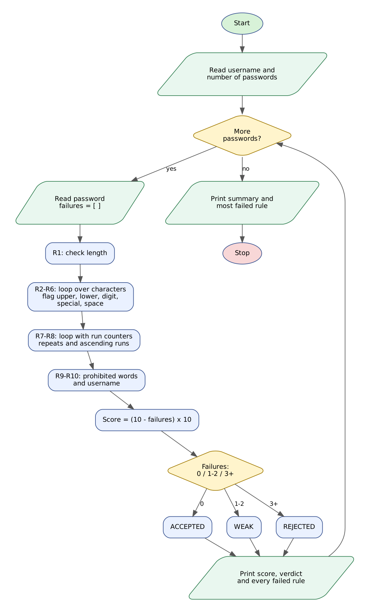

# Case Study 29: Password Policy Validation Engine

> Python Activity-Based Learning - case study **#29** from the given list of 100.

## 1. Problem Statement

Weak passwords are the easiest way into a student portal or a hospital system. An organisation therefore publishes a **password policy** and rejects any password that breaks it. Users, however, become frustrated when the system only says "invalid password". A good validator must **explain every failed rule** so the user knows exactly what to change.

Write a Python program that tests a batch of sample passwords against ten rules - length, uppercase, lowercase, digit, special character, no spaces, no repeated characters, no ascending sequence, no prohibited words and no username - and prints a score, a verdict and an explanation for each failed condition, followed by a summary.

## 2. Objectives

- Examine strings character by character with loops, indexing and slicing.
- Use string methods (`isupper`, `islower`, `isdigit`, `isalnum`, `lower`) and the `in` operator.
- Detect patterns: repeated characters and ascending runs such as `abcd` or `1234`.
- Collect all failures in a list so every broken rule is reported, not just the first.
- Classify passwords and report the most frequently failed rule.

## 3. Assumptions

- Length must be 10 to 32 characters. Special characters allowed by the policy: `!@#$%^&*()-_+=`.
- R7: the same character must not appear three or more times in a row (case-sensitive).
- R8: no run of four or more consecutive ascending letters or digits (for example `abcd`, `1234`); checked ignoring case.
- R9: prohibited words (checked ignoring case): password, admin, qwerty, welcome, college, letmein.
- R10: the password must not contain the username (only enforced if the username has 3 or more characters).
- Verdict: 0 failures = ACCEPTED, 1-2 failures = WEAK, 3 or more = REJECTED. Score = 10 points per rule passed.
- Passwords used for testing are samples, not real credentials.

## 4. Algorithm

1. Read the username and the number of passwords to test.
2. For each password create empty lists `failures` and `failed_rules`.
3. R1: compare `len(password)` with the minimum and maximum length.
4. R2-R6: loop over the characters and set a flag for uppercase, lowercase, digit, special character and space; report each missing or forbidden category.
5. R7-R8: loop from the second character; keep a run counter for equal neighbours and another for ascending neighbours (using character codes); record the first offending pattern.
6. R9: for each prohibited word test whether it occurs in the lower-case password.
7. R10: test whether the username occurs in the lower-case password.
8. Score = (10 - number of failures) x 10; choose the verdict from the number of failures.
9. Print the score, verdict and one line for every failure.
10. After all passwords print the counts of accepted/weak/rejected and the most frequently failed rule.

## 5. Flowchart



*(Graphviz source: [flowchart.dot](flowchart.dot))*

## 6. Pseudocode

```text
START
  MIN_LEN <- 10; MAX_LEN <- 32; SPECIALS <- "!@#$%^&*()-_+="
  PROHIBITED <- [password, admin, qwerty, welcome, college, letmein]
  READ username, n; accepted <- weak <- rejected <- 0; rule_fail_count <- [0]*10
  FOR i <- 1 TO n
      READ pw; lw <- LOWER(pw); failures <- [ ]
      IF LEN(pw) < MIN_LEN OR LEN(pw) > MAX_LEN THEN ADD R1 message
      FOR EACH ch IN pw
          IF ch is upper THEN has_upper <- TRUE
          ELSE IF ch is lower THEN has_lower <- TRUE
          ELSE IF ch is digit THEN has_digit <- TRUE
          ELSE IF ch = " " THEN has_space <- TRUE
          ELSE IF ch IN SPECIALS THEN has_special <- TRUE
      IF NOT has_upper THEN ADD R2;  (same for R3, R4, R5)
      IF has_space THEN ADD R6
      run <- 1; arun <- 1
      FOR k <- 2 TO LEN(pw)
          IF pw[k] = pw[k-1] THEN run <- run + 1 ELSE run <- 1
          IF run >= 3 THEN remember repeated pattern
          IF lw[k], lw[k-1] alphanumeric AND code(lw[k]) = code(lw[k-1]) + 1
               THEN arun <- arun + 1 ELSE arun <- 1
          IF arun >= 4 THEN remember sequence lw[k-3..k]
      IF repeated found THEN ADD R7;  IF sequence found THEN ADD R8
      found <- words of PROHIBITED that occur in lw;  IF found not empty THEN ADD R9
      IF LEN(username) >= 3 AND username IN lw THEN ADD R10
      bad <- COUNT(failures);  score <- (10 - bad) * 10
      IF bad = 0 THEN ACCEPTED ELSE IF bad <= 2 THEN WEAK ELSE REJECTED
      PRINT score, verdict, every failure
  END FOR
  PRINT summary and most frequently failed rule
END
```

## 7. Python Source Code

File: [`password_validator.py`](password_validator.py)

```python
# =====================================================================
# CS29 : Password Policy Validation Engine
# Syllabus used : variables, data types, operators, conditionals,
#                 loops, strings (indexing, slicing, methods), lists
# =====================================================================

print("=" * 66)
print("            PASSWORD POLICY VALIDATION ENGINE")
print("=" * 66)

# ---------------- Policy (constants) ----------------
MIN_LEN = 10
MAX_LEN = 32
SPECIALS = "!@#$%^&*()-_+="
PROHIBITED = ["password", "admin", "qwerty", "welcome", "college", "letmein"]
RULE_TITLES = ["Length", "Uppercase letter", "Lowercase letter", "Digit",
               "Special character", "No spaces", "No repeated characters",
               "No ascending sequence", "No prohibited words", "No username"]

username = input("Username (password must not contain it) : ").strip().lower()
text = input("How many passwords to test : ")
while not text.isdigit() or int(text) == 0:
    text = input("  Enter a positive whole number : ")
n = int(text)

accepted = 0
weak = 0
rejected = 0
rule_fail_count = [0] * 10     # how many passwords failed each rule

for i in range(n):
    pw = input("\nPassword " + str(i + 1) + " : ")
    lw = pw.lower()
    size = len(pw)
    failures = []              # explanation of every failed rule
    failed_rules = []          # rule numbers that failed

    # R1 : length
    if size < MIN_LEN:
        failures.append("R1 Length is " + str(size) + "; at least " + str(MIN_LEN) +
                        " characters are required")
        failed_rules.append(0)
    elif size > MAX_LEN:
        failures.append("R1 Length is " + str(size) + "; at most " + str(MAX_LEN) +
                        " characters are allowed")
        failed_rules.append(0)

    # R2-R6 : character categories
    has_upper = False
    has_lower = False
    has_digit = False
    has_special = False
    has_space = False
    for ch in pw:
        if ch.isupper():
            has_upper = True
        elif ch.islower():
            has_lower = True
        elif ch.isdigit():
            has_digit = True
        elif ch == " ":
            has_space = True
        elif ch in SPECIALS:
            has_special = True
    if not has_upper:
        failures.append("R2 No uppercase letter (A-Z) found")
        failed_rules.append(1)
    if not has_lower:
        failures.append("R3 No lowercase letter (a-z) found")
        failed_rules.append(2)
    if not has_digit:
        failures.append("R4 No digit (0-9) found")
        failed_rules.append(3)
    if not has_special:
        failures.append("R5 No special character from " + SPECIALS + " found")
        failed_rules.append(4)
    if has_space:
        failures.append("R6 Password must not contain spaces")
        failed_rules.append(5)

    # R7 : same character three or more times in a row / R8 : ascending run of 4+
    run = 1
    arun = 1
    repeated = ""
    sequence = ""
    for k in range(1, size):
        if pw[k] == pw[k - 1]:
            run += 1
        else:
            run = 1
        if run >= 3 and repeated == "":
            repeated = pw[k] * 3

        if lw[k].isalnum() and lw[k - 1].isalnum() and ord(lw[k]) == ord(lw[k - 1]) + 1:
            arun += 1
        else:
            arun = 1
        if arun >= 4 and sequence == "":
            sequence = lw[k - 3:k + 1]
    if repeated != "":
        failures.append("R7 Same character repeated 3+ times in a row ('" + repeated + "')")
        failed_rules.append(6)
    if sequence != "":
        failures.append("R8 Ascending sequence of 4+ characters found ('" + sequence + "')")
        failed_rules.append(7)

    # R9 : prohibited words
    found = []
    for word in PROHIBITED:
        if word in lw:
            found.append(word)
    if len(found) > 0:
        failures.append("R9 Contains prohibited word(s): " + ", ".join(found))
        failed_rules.append(8)

    # R10 : username
    if len(username) >= 3 and username in lw:
        failures.append("R10 Password contains the username '" + username + "'")
        failed_rules.append(9)

    # ---------------- Verdict ----------------
    bad = len(failures)
    score = (10 - bad) * 10
    if bad == 0:
        verdict = "ACCEPTED (Strong)"
        accepted += 1
    elif bad <= 2:
        verdict = "WEAK - fix the listed problems"
        weak += 1
    else:
        verdict = "REJECTED (Very weak)"
        rejected += 1

    print("  Score   : " + str(score) + "/100   (" + str(10 - bad) + " of 10 rules passed)")
    print("  Verdict : " + verdict)
    for f in failures:
        print("    [FAIL] " + f)
    for r in failed_rules:
        rule_fail_count[r] += 1

# ---------------- Summary ----------------
print("\n" + "=" * 66)
print("SUMMARY : tested = " + str(n) + ", accepted = " + str(accepted) +
      ", weak = " + str(weak) + ", rejected = " + str(rejected))
worst = 0
for r in range(10):
    if rule_fail_count[r] > rule_fail_count[worst]:
        worst = r
if rule_fail_count[worst] == 0:
    print("Every password satisfied every rule.")
else:
    print("Most frequently failed rule : R" + str(worst + 1) + " " + RULE_TITLES[worst] +
          " (" + str(rule_fail_count[worst]) + " password(s))")
```

**How to run**

```bash
# interactive - type the inputs yourself
python password_validator.py

# or replay a prepared test (Linux/macOS)
python password_validator.py < tests/test1_input.txt

# Windows PowerShell
Get-Content tests\test1_input.txt | python password_validator.py
```

## 8. Test Cases

Every test has an input file (`tests/testN_input.txt`) and the program's real output (`tests/testN_output.txt`). The expected results below were checked against the output.

| # | Scenario | Key expected results (checked automatically) | Input | Result |
|---|----------|-----------------------------------------------|-------|--------|
| T1 | **Eight different passwords against all ten rules**<br>One strong password and seven that break one or more rules; every failure is explained. | `ACCEPTED (Strong)`<br>`REJECTED (Very weak)`<br>`R7 Same character repeated 3+ times in a row ('!!!')`<br>`R1 Length is 4; at least 10`<br>`R8 Ascending sequence of 4+ characters found ('abcd')`<br>+ 5 more checks | [test1_input.txt](tests/test1_input.txt) | PASS |
| T2 | **All passwords satisfy the policy**<br>Two strong passwords; a very short username (under 3 letters) is not enforced. | `Every password satisfied every rule.`<br>`accepted = 2`<br>`Score   : 100/100` | [test2_input.txt](tests/test2_input.txt) | PASS |
| T3 | **Too long and case-insensitive prohibited word**<br>A 35-character password and 'QWERTY' in capitals. | `at most 32 characters`<br>`prohibited word(s): qwerty`<br>`weak = 2` | [test3_input.txt](tests/test3_input.txt) | PASS |

<details><summary>Input typed in test T1</summary>

```text
sai
8
Tr@vel2Hills!9
password123
Aaa!!!bbb111
Ab1!
ABCD@efgh1234
My Pass@2026x
Admin@Welcome9
Sai@Coll3ge#77
```
</details>

<details><summary>Input typed in test T2</summary>

```text
x
2
Blue#Mountain47
Z9$kLm!Qw2pR
```
</details>

<details><summary>Input typed in test T3</summary>

```text
guest
2
Str0ng!Str0ng!Str0ng!Str0ng!Str0ng!
QWERTY!qwerty12
```
</details>

## 9. Output Screenshots

Typed input is shown in green.

**T1 - Eight different passwords against all ten rules**


**T2 - All passwords satisfy the policy**


**T3 - Too long and case-insensitive prohibited word**


## 10. Conclusion

The validator does more than say yes or no: it tells the user which of the ten rules failed and why, which is what makes a policy usable. Looping over characters with run counters detected repeated characters and ascending sequences, and collecting failures in a list guaranteed that every broken rule is reported together. In the main test, eight passwords produced one ACCEPTED, six WEAK and one REJECTED result, and the summary correctly identified the prohibited-word rule as the most frequently failed. All three test cases passed.
