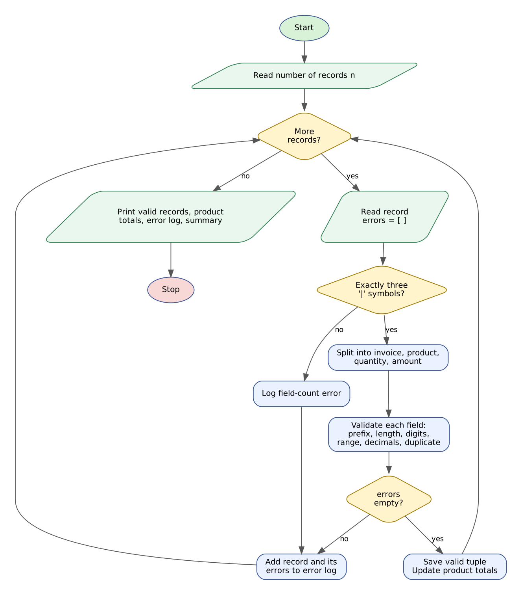

# Case Study 32: Text-Based Invoice Data Extraction

> Python Activity-Based Learning - case study **#32** from the given list of 100.

| | |
|---|---|
| **Source file** | [`invoice_extraction.py`](invoice_extraction.py) |
| **Syllabus used** | Variables, data types, operators, conditional statements, loops, strings (slicing, split, count, validation methods), lists, tuples, unpacking |
| **Test cases** | 3 of 3 passed |
| **Python version** | 3.8 or newer, no external libraries |

**Contents:** [1 Problem](#1-problem-statement) | [2 Objectives](#2-objectives) | [3 Assumptions](#3-assumptions) | [4 Algorithm](#4-algorithm) | [5 Flowchart](#5-flowchart) | [6 Pseudocode](#6-pseudocode) | [7 Source code](#7-python-source-code) | [8 Test cases](#8-test-cases) | [9 Screenshots](#9-output-screenshots) | [10 Conclusion](#10-conclusion)

---

## 1. Problem Statement

Many small businesses still receive orders and invoices as lines of plain text copied from e-mails, messages or old software. Before the accounts team can use the data, each line must be **read, checked and converted into numbers**. A single typing error - a missing separator, a lower-case product code, a quantity written as text - can corrupt the totals.

Write a Python program that reads formatted invoice strings of the form `INV-2026-014|PRD:AB101|QTY:12|AMT:540.50`, extracts the invoice number, product code, quantity and amount using only basic string operations, **flags every malformed record with the reason**, detects duplicate invoice numbers, and reports product-wise totals for the valid records.

## 2. Objectives

- Split and slice strings to extract fields from a fixed text format.
- Validate each field with string methods (`isdigit`, `isalpha`, `isupper`, `count`, `split`).
- Convert text to `int` and `float` only after it has been validated.
- Keep valid records as tuples and aggregate quantities and amounts in parallel lists.
- Produce a detailed error log that lists every problem in every bad record.

## 3. Assumptions

- A record has exactly four fields separated by three `|` symbols.
- Invoice number: `INV-YYYY-NNN` (12 characters, year and serial are digits).
- Product code: `PRD:` followed by two capital letters and three digits, for example `PRD:AB101`.
- Quantity: `QTY:` followed by a whole number from 1 to 999.
- Amount: `AMT:` followed by digits, a decimal point and **exactly two decimals**, greater than zero.
- An invoice number that was already accepted is a duplicate; the first occurrence is kept.
- Empty lines and free text are treated as malformed records.

## 4. Algorithm

1. Read the number of records `n` (positive whole number).
2. For each record count the `|` symbols. If the count is not 3, log a field-count error.
3. Otherwise split into four fields and strip spaces (tuple-style unpacking).
4. Invoice: check length 12, prefix `INV-`, a dash at position 8 and digit groups; also check for duplicates.
5. Product: check the prefix `PRD:`, then the code - two upper-case letters followed by three digits.
6. Quantity: check the prefix `QTY:`, that the rest is digits and that the value is between 1 and 999.
7. Amount: check the prefix `AMT:`, split on `.` into exactly two digit-only parts with two decimals, and that the value is above zero.
8. If no error was found, store `(invoice, code, qty, amount)` and add the quantity and amount to the product's totals; otherwise store the record with all its errors.
9. Print the valid records, product-wise totals and the highest-value product.
10. Print every malformed record with its reasons and the final summary.

## 5. Flowchart



*(Graphviz source: [flowchart.dot](flowchart.dot))*

## 6. Pseudocode

```text
START
  READ n
  valid <- [ ]; errors_log <- [ ]; seen <- [ ]; codes <- [ ]; code_qty <- [ ]; code_amt <- [ ]
  FOR i <- 1 TO n
      READ rec; errors <- [ ]
      IF COUNT(rec, "|") != 3 THEN ADD field-count error
      ELSE
          (inv, prd, qty, amt) <- SPLIT(rec, "|"), each stripped
          IF LEN(inv) != 12 OR inv[0:4] != "INV-" OR inv[8] != "-"
             OR NOT DIGITS(inv[4:8]) OR NOT DIGITS(inv[9:12]) THEN ADD invoice error
          ELSE IF inv IN seen THEN ADD duplicate error
          IF prd[0:4] != "PRD:" THEN ADD prefix error
          ELSE code <- prd[4:]
               IF LEN(code) != 5 OR NOT ALPHA-UPPER(code[0:2]) OR NOT DIGITS(code[2:5])
                   THEN ADD product-code error
          IF qty[0:4] != "QTY:" THEN ADD prefix error
          ELSE q <- qty[4:]; IF NOT DIGITS(q) OR q < 1 OR q > 999 THEN ADD quantity error
          IF amt[0:4] != "AMT:" THEN ADD prefix error
          ELSE pieces <- SPLIT(amt[4:], ".")
               IF COUNT(pieces) != 2 OR parts not digits OR LEN(pieces[1]) != 2
                   THEN ADD decimal-format error
               ELSE IF value <= 0 THEN ADD zero-amount error
      IF errors is empty THEN
          ADD inv TO seen; ADD (inv, code, q, a) TO valid; UPDATE totals for code
      ELSE ADD (i, rec, errors) TO errors_log
  END FOR
  PRINT valid records, product-wise totals, highest-value product
  PRINT errors_log and summary
END
```

## 7. Python Source Code

File: [`invoice_extraction.py`](invoice_extraction.py)

```python
# =====================================================================
# CS32 : Text-Based Invoice Data Extraction
# Syllabus used : variables, data types, operators, conditionals,
#                 loops, strings (slicing, split, find, count,
#                 isdigit, isalpha, isupper), lists, tuples, unpacking
# =====================================================================

print("=" * 72)
print("           TEXT-BASED INVOICE DATA EXTRACTION")
print("=" * 72)
print("Record format : INV-YYYY-NNN|PRD:AA999|QTY:n|AMT:0000.00")

text = input("Number of invoice records : ")
while not text.isdigit() or int(text) == 0:
    text = input("  Enter a positive whole number : ")
n = int(text)

valid_records = []     # tuples: (invoice, product, qty, amount)
error_log = []         # tuples: (record_no, text, [errors])
seen_invoices = []
codes = []             # product-wise totals kept in parallel lists
code_qty = []
code_amt = []

for i in range(n):
    rec = input("Record " + str(i + 1) + " : ").strip()
    errors = []

    if rec.count("|") != 3:
        errors.append("Expected 4 fields separated by 3 '|' symbols (found " +
                      str(rec.count("|") + 1) + " field(s))")
    else:
        inv, prd, qty, amt = rec.split("|")        # tuple-style unpacking
        inv = inv.strip()
        prd = prd.strip()
        qty = qty.strip()
        amt = amt.strip()
        code = ""
        q = 0
        a = 0.0

        # ---- invoice number : INV-YYYY-NNN ----
        if (len(inv) != 12 or inv[0:4] != "INV-" or inv[8] != "-"
                or not inv[4:8].isdigit() or not inv[9:12].isdigit()):
            errors.append("Invoice number '" + inv + "' must look like INV-2026-014")
        elif inv in seen_invoices:
            errors.append("Duplicate invoice number " + inv)

        # ---- product code : PRD:AA999 ----
        if prd[0:4] != "PRD:":
            errors.append("Product field must start with 'PRD:'")
        else:
            code = prd[4:]
            if (len(code) != 5 or not code[0:2].isalpha() or not code[0:2].isupper()
                    or not code[2:5].isdigit()):
                errors.append("Product code '" + code + "' must be 2 capital letters + 3 digits")
                code = ""

        # ---- quantity : QTY:1..999 ----
        if qty[0:4] != "QTY:":
            errors.append("Quantity field must start with 'QTY:'")
        else:
            qt = qty[4:]
            if not qt.isdigit():
                errors.append("Quantity '" + qt + "' is not a whole number")
            elif int(qt) < 1 or int(qt) > 999:
                errors.append("Quantity " + qt + " is outside the range 1-999")
            else:
                q = int(qt)

        # ---- amount : AMT:digits.dd ----
        if amt[0:4] != "AMT:":
            errors.append("Amount field must start with 'AMT:'")
        else:
            at = amt[4:]
            pieces = at.split(".")
            if (len(pieces) != 2 or not pieces[0].isdigit() or not pieces[1].isdigit()
                    or len(pieces[1]) != 2):
                errors.append("Amount '" + at + "' must have exactly two decimal places")
            else:
                a = float(at)
                if a <= 0:
                    errors.append("Amount must be greater than zero")

        if len(errors) == 0:
            seen_invoices.append(inv)
            valid_records.append((inv, code, q, a))
            pos = -1
            for k in range(len(codes)):
                if codes[k] == code:
                    pos = k
            if pos == -1:
                codes.append(code)
                code_qty.append(q)
                code_amt.append(a)
            else:
                code_qty[pos] += q
                code_amt[pos] += a

    if len(errors) > 0:
        error_log.append((i + 1, rec, errors))

# ---------------- Report ----------------
print("\n" + "=" * 72)
print("EXTRACTED VALID RECORDS")
print("=" * 72)
if len(valid_records) == 0:
    print("No valid records found.")
else:
    print(f"{'Invoice':<14}{'Product':<10}{'Qty':>6}{'Amount':>12}")
    print("-" * 42)
    total_qty = 0
    total_amt = 0.0
    for rec in valid_records:
        inv, code, q, a = rec
        total_qty += q
        total_amt += a
        print(f"{inv:<14}{code:<10}{q:>6}{a:>12.2f}")
    print("-" * 42)
    print(f"{'TOTAL':<24}{total_qty:>6}{total_amt:>12.2f}")

    print("\nPRODUCT-WISE TOTALS")
    print("-" * 42)
    best = 0
    for k in range(len(codes)):
        print(f"{codes[k]:<14}{'':<10}{code_qty[k]:>6}{code_amt[k]:>12.2f}")
        if code_amt[k] > code_amt[best]:
            best = k
    print("Highest-value product : " + codes[best] + " (Rs. " + f"{code_amt[best]:.2f}" + ")")

print("\n" + "=" * 72)
print("MALFORMED RECORDS FLAGGED")
print("=" * 72)
if len(error_log) == 0:
    print("None")
else:
    for item in error_log:
        number, original, problems = item
        shown = original
        if shown == "":
            shown = "(empty line)"
        print("Record " + str(number) + " : " + shown)
        for p in problems:
            print("   - " + p)

print("\nSUMMARY : records = " + str(n) + ", valid = " + str(len(valid_records)) +
      ", malformed = " + str(len(error_log)))
```

**How to run**

```bash
# interactive - type the inputs yourself
python invoice_extraction.py

# or replay a prepared test (Linux/macOS)
python invoice_extraction.py < tests/test1_input.txt

# Windows PowerShell
Get-Content tests\test1_input.txt | python invoice_extraction.py
```

## 8. Test Cases

Every test has an input file (`tests/testN_input.txt`) and the program's real output (`tests/testN_output.txt`). The expected results below were checked against the output.

| # | Scenario | Key expected results (checked automatically) | Input | Result |
|---|----------|-----------------------------------------------|-------|--------|
| T1 | **Ten records: three valid, seven malformed in different ways**<br>Duplicate invoice, lowercase code, zero quantity, one-decimal amount, wrong separator, missing field, text quantity. | `valid = 3, malformed = 7`<br>`Duplicate invoice number INV-2026-002`<br>`must be 2 capital letters + 3 digits`<br>`outside the range 1-999`<br>`exactly two decimal places`<br>+ 4 more checks | [test1_input.txt](tests/test1_input.txt) | PASS |
| T2 | **All records valid with boundary quantities**<br>Quantity 1 and 999 and product totals aggregated across invoices. | `valid = 4, malformed = 0`<br>`Highest-value product : CC003`<br>`None` | [test2_input.txt](tests/test2_input.txt) | PASS |
| T3 | **Only bad records: empty line, zero amount, plain text, wrong label**<br>Nothing can be extracted; every record is flagged with its reason. | `No valid records found.`<br>`(empty line)`<br>`Amount must be greater than zero`<br>`Product field must start with 'PRD:'`<br>`valid = 0, malformed = 4` | [test3_input.txt](tests/test3_input.txt) | PASS |

<details><summary>Input typed in test T1</summary>

```text
10
INV-2026-001|PRD:AB101|QTY:12|AMT:540.50
INV-2026-002|PRD:CD205|QTY:5|AMT:1250.00
INV-2026-003|PRD:AB101|QTY:8|AMT:360.25
INV-2026-002|PRD:EF300|QTY:2|AMT:99.99
INV-2026-004|PRD:ab101|QTY:3|AMT:45.00
INV-2026-005|PRD:GH400|QTY:0|AMT:10.00
INV-2026-006|PRD:GH400|QTY:4|AMT:12.5
INV2026-007|PRD:IJ500|QTY:1|AMT:15.00
INV-2026-008|PRD:KL600|QTY:2
INV-2026-009|PRD:MN700|QTY:abc|AMT:20.00
```
</details>

<details><summary>Input typed in test T2</summary>

```text
4
INV-2026-101|PRD:AA001|QTY:10|AMT:100.00
INV-2026-102|PRD:BB002|QTY:1|AMT:999.99
INV-2026-103|PRD:AA001|QTY:5|AMT:50.00
INV-2026-104|PRD:CC003|QTY:999|AMT:9999.00
```
</details>

<details><summary>Input typed in test T3</summary>

```text
4

INV-2026-001|PRD:AB101|QTY:1|AMT:0.00
random text
INV-2026-002|ITEM:AB101|QTY:2|AMT:5.00
```
</details>

## 9. Output Screenshots

Typed input is shown in green.

**T1 - Ten records: three valid, seven malformed in different ways**


**T2 - All records valid with boundary quantities**


**T3 - Only bad records: empty line, zero amount, plain text, wrong label**


## 10. Conclusion

The program extracts reliable data from unreliable text. Validating *before* converting to numbers prevented crashes, and reporting every error of every record lets the accounts team correct the source instead of guessing. In the main test, 3 of 10 records were accepted and 7 were flagged for seven different reasons (duplicate invoice, lowercase code, zero quantity, one-decimal amount, wrong separator, missing field, text quantity), and the product totals matched hand calculation. All three test cases passed.
