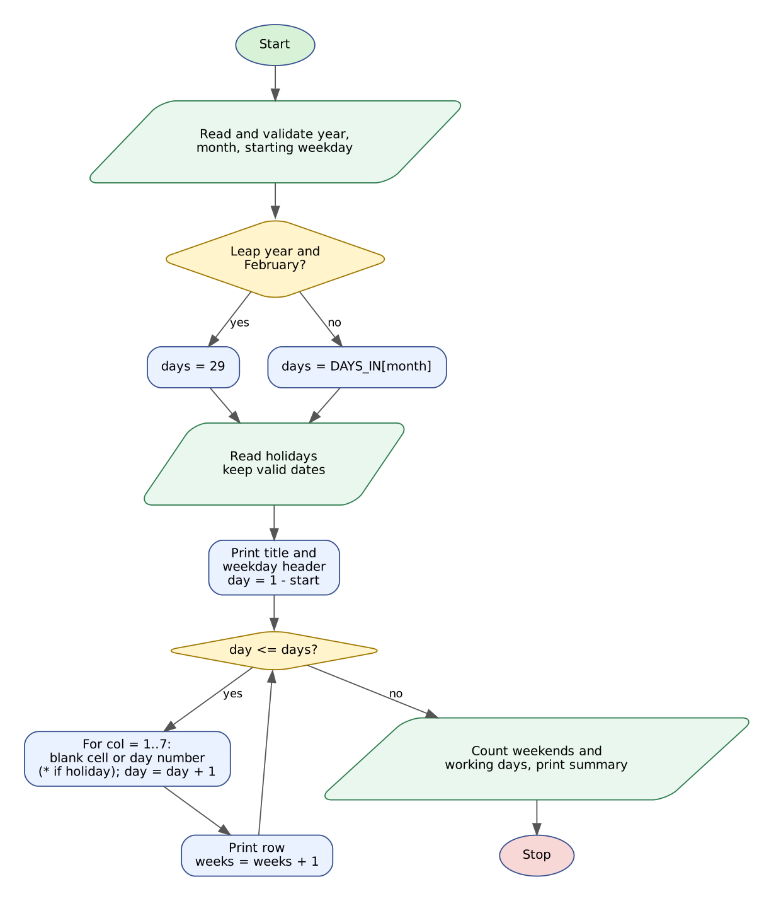

# Case Study 37: Nested Loop Calendar Generator

> Python Activity-Based Learning - case study **#37** from the given list of 100.

---

## 1. Problem Statement

Wall calendars, timetables and duty rosters all rely on one idea: arranging numbered days into weekly rows so that every date sits under the correct weekday. The program must produce a **neatly aligned monthly calendar** when it is told the year, the month and the weekday on which the 1st falls.

It must work out the correct number of days (including the **leap-year rule** for February), leave blank cells before the 1st, start a new row after every Sunday, mark optional holiday dates with `*`, and finally report how many weekend and working days the month has.

## 2. Objectives

- Use a `while` loop for weeks and a nested `for` loop for the seven weekday columns.
- Apply conditional logic and the leap-year rule to find the length of a month.
- Align text with fixed-width formatting and string methods (`center`, `rstrip`).
- Validate year, month, weekday and holiday inputs with loops and string methods.
- Use lists for month names, month lengths and weekday names; calculate weekend and working days.

## 3. Assumptions

- The week runs Monday to Sunday; Saturday and Sunday are weekend days.
- The user supplies the weekday of the 1st (the program does not look it up). Names such as `Thu` or `Thursday` are accepted in any case.
- Supported years: 1900-2100. Leap year: divisible by 4 and not by 100, or divisible by 400.
- Holiday dates are optional, comma-separated numbers within the month; invalid or repeated entries are ignored with a message.
- Working days = days in month - weekend days - holidays that fall on weekdays.

## 4. Algorithm

1. Read and validate the year (1900-2100) and month (1-12).
2. Read the starting weekday; convert it to an index 0-6 (Mon = 0) by searching the weekday list.
3. Decide whether the year is a leap year and set the number of days (29 for a leap February).
4. Read the optional holiday list and keep only valid, distinct dates.
5. Print the centred title and the weekday header.
6. Set `day = 1 - start` so the first cell of the first week is blank for the days before the 1st.
7. While `day <= days`: for each of 7 columns print blank if `day < 1` or `day > days`, otherwise the day number with a `*` if it is a holiday; then increase `day`.
8. Print the row without trailing spaces and count one week.
9. Count weekend days using `(start + d - 1) mod 7 >= 5` and holidays on weekdays.
10. Print days, weeks, ending weekday, weekend days and working days.

## 5. Flowchart



*(Graphviz source: [flowchart.dot](flowchart.dot))*

## 6. Pseudocode

```text
START
  MONTHS, DAYS_IN, WEEKDAYS <- lists
  READ year (1900-2100); READ month (1-12)           (re-ask until valid)
  READ weekday; start <- INDEX of weekday in WEEKDAYS (re-ask until found)
  leap <- (year MOD 4 = 0 AND year MOD 100 != 0) OR (year MOD 400 = 0)
  days <- DAYS_IN[month]; IF month = 2 AND leap THEN days <- 29
  READ holiday text; holidays <- valid distinct numbers in 1..days
  PRINT centred title and weekday header
  day <- 1 - start; weeks <- 0
  WHILE day <= days
      line <- ""
      FOR col <- 1 TO 7
          IF day < 1 OR day > days THEN line <- line + "    "
          ELSE
              mark <- " "; IF day IN holidays THEN mark <- "*"
              line <- line + RIGHT-ALIGN(day, 2) + mark + " "
          day <- day + 1
      PRINT line without trailing spaces; weeks <- weeks + 1
  weekend <- number of d in 1..days with (start + d - 1) MOD 7 >= 5
  hw <- number of holidays with (start + h - 1) MOD 7 < 5
  PRINT days, weeks, ending weekday, weekend, working <- days - weekend - hw
END
```

## 7. Python Source Code

File: [`calendar_generator.py`](calendar_generator.py)

```python
# =====================================================================
# CS37 : Nested Loop Calendar Generator
# Syllabus used : variables, data types, operators, conditionals,
#                 loops, nested loops, strings, lists, pattern generation
# =====================================================================

print("=" * 50)
print("          MONTHLY CALENDAR GENERATOR")
print("=" * 50)

MONTHS = ["January", "February", "March", "April", "May", "June", "July",
          "August", "September", "October", "November", "December"]
DAYS_IN = [31, 28, 31, 30, 31, 30, 31, 31, 30, 31, 30, 31]
WEEKDAYS = ["Mon", "Tue", "Wed", "Thu", "Fri", "Sat", "Sun"]

# ---------------- Input with validation ----------------
text = input("Year (1900-2100) : ").strip()
while not text.isdigit() or int(text) < 1900 or int(text) > 2100:
    text = input("  Invalid year. Enter a year between 1900 and 2100 : ").strip()
year = int(text)

text = input("Month number (1-12) : ").strip()
while not text.isdigit() or int(text) < 1 or int(text) > 12:
    text = input("  Invalid month. Enter 1-12 : ").strip()
month = int(text)

start = -1
while start == -1:
    wd = input("Weekday of the 1st (Mon/Tue/Wed/Thu/Fri/Sat/Sun) : ").strip().capitalize()[0:3]
    for k in range(7):
        if WEEKDAYS[k] == wd:
            start = k
    if start == -1:
        print("  Invalid weekday. Use names such as Mon, Tue, Wed ...")

# ---------------- Month length with leap-year rule ----------------
leap = (year % 4 == 0 and year % 100 != 0) or (year % 400 == 0)
days = DAYS_IN[month - 1]
if month == 2 and leap:
    days = 29

# ---------------- Optional holiday dates ----------------
raw = input("Holiday dates, comma-separated (blank for none) : ")
holidays = []
if raw.strip() != "":
    for token in raw.split(","):
        t = token.strip()
        if t.isdigit() and 1 <= int(t) <= days:
            if int(t) not in holidays:
                holidays.append(int(t))
        else:
            print("  Ignored invalid holiday date '" + t + "'")

# ---------------- Print the calendar ----------------
title = MONTHS[month - 1] + " " + str(year)
print()
print(title.center(28))
print("-" * 28)
header = ""
for name in WEEKDAYS:
    header += f"{name:<4}"
print(header.rstrip())

day = 1 - start           # number in the first cell (zero/negative = blank cell)
weeks = 0
while day <= days:        # one pass of the while loop = one week row
    line = ""
    for col in range(7):  # nested loop = seven columns of the week
        if day < 1 or day > days:
            line += "    "
        else:
            mark = " "
            if day in holidays:
                mark = "*"
            line += f"{day:>2}{mark} "
        day += 1
    print(line.rstrip())
    weeks += 1
print("-" * 28)
if len(holidays) > 0:
    print("* = holiday")

# ---------------- Summary ----------------
weekend = 0
for d in range(1, days + 1):
    if (start + d - 1) % 7 >= 5:
        weekend += 1
holiday_on_weekday = 0
for h in holidays:
    if (start + h - 1) % 7 < 5:
        holiday_on_weekday += 1
working = days - weekend - holiday_on_weekday

leap_note = ""
if month == 2 and leap:
    leap_note = " (leap year)"
print("\nDays in month        : " + str(days) + leap_note)
print("Weeks shown          : " + str(weeks))
print("Month ends on        : " + WEEKDAYS[(start + days - 1) % 7])
print("Weekend days (Sat/Sun): " + str(weekend))
print("Holidays on weekdays : " + str(holiday_on_weekday))
print("Working days         : " + str(working))
```

**How to run**

```bash
# interactive - type the inputs yourself
python calendar_generator.py

# or replay a prepared test (Linux/macOS)
python calendar_generator.py < tests/test1_input.txt

# Windows PowerShell
Get-Content tests\test1_input.txt | python calendar_generator.py
```

## 8. Test Cases

Every test has an input file (`tests/testN_input.txt`) and the program's real output (`tests/testN_output.txt`). The expected results below were checked against the output.

| # | Scenario | Key expected results (checked automatically) | Input | Result |
|---|----------|-----------------------------------------------|-------|--------|
| T1 | **October 2026 starting on Thursday with two holidays**<br>31-day month, five week rows, holidays on the 2nd and 20th marked with *. | `October 2026`<br>`Days in month        : 31`<br>`Weeks shown          : 5`<br>`Month ends on        : Sat`<br>`Weekend days (Sat/Sun): 9`<br>+ 2 more checks | [test1_input.txt](tests/test1_input.txt) | PASS |
| T2 | **Leap-year February 2028 starting on Tuesday**<br>The leap-year rule gives 29 days. | `Days in month        : 29 (leap year)`<br>`Month ends on        : Tue`<br>`Weeks shown          : 5`<br>`Working days         : 21` | [test2_input.txt](tests/test2_input.txt) | PASS |
| T3 | **Non-leap February 2027 (exactly four weeks) with invalid holidays**<br>Full weekday name accepted; 30 and 'abc' are ignored; the 14th is a Sunday holiday. | `Days in month        : 28`<br>`Weeks shown          : 4`<br>`Ignored invalid holiday date '30'`<br>`Ignored invalid holiday date 'abc'`<br>`Working days         : 20` | [test3_input.txt](tests/test3_input.txt) | PASS |
| T4 | **Six-row month and validation of every input**<br>August 2027 starts on Sunday so it needs six rows; bad year, month and weekday are re-asked. | `Invalid year`<br>`Invalid month`<br>`Invalid weekday`<br>`Weeks shown          : 6`<br>`Month ends on        : Tue` | [test4_input.txt](tests/test4_input.txt) | PASS |

<details><summary>Input typed in test T1</summary>

```text
2026
10
Thu
2,20
```
</details>

<details><summary>Input typed in test T2</summary>

```text
2028
2
Tue

```
</details>

<details><summary>Input typed in test T3</summary>

```text
2027
2
Monday
14,30,abc
```
</details>

<details><summary>Input typed in test T4</summary>

```text
abcd
1899
2027
13
0
8
Funday
Sun
1
```
</details>

## 9. Output Screenshots

Typed input is shown in green.

**T1 - October 2026 starting on Thursday with two holidays**


**T2 - Leap-year February 2028 starting on Tuesday**


**T3 - Non-leap February 2027 (exactly four weeks) with invalid holidays**


**T4 - Six-row month and validation of every input**


## 10. Conclusion

The generator prints correctly aligned calendars for 28-, 29- and 31-day months, including a month that needs six rows (August 2027). The trick of starting the counter at `1 - start` lets one nested loop handle the leading blanks, the dates and the trailing blanks without special cases. The leap-year rule, holiday markers and working-day count make the output useful for real planning. All four test cases passed, including invalid year, month, weekday and holiday entries.
