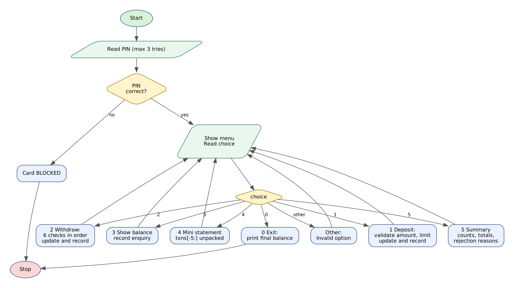

# Case Study 38: ATM Menu-Driven Banking Simulation

> Python Activity-Based Learning - case study **#38** from the given list of 100.


## 1. Problem Statement

An ATM is a menu-driven program that must be **safe even when the user makes mistakes**. After the card holder enters a PIN, the machine repeatedly shows a menu and carries out deposits, withdrawals, balance enquiries and statements, always enforcing the bank's limits. Every attempt - successful or rejected - must be recorded so that a transaction summary can be produced later.

Write a Python program that simulates one ATM session for an account with an opening balance of Rs. 25000. It must verify the PIN (three attempts), validate all amounts, enforce the account limits, keep a transaction history as tuples and display a mini statement and a summary on request.

## 2. Objectives

- Build a menu-driven program with a `while` loop and an `if / elif / else` chain.
- Validate input strings before converting them to numbers.
- Enforce several business rules in the correct priority order.
- Store every transaction as a tuple in a list and read it back using unpacking and slicing.
- Produce a mini statement (last five records) and an audit-style summary including rejection reasons.

## 3. Assumptions

- Correct PIN is `4321`; three wrong attempts block the card.
- Opening balance Rs. 25000. Amounts must be whole numbers, greater than zero and multiples of Rs. 100.
- Per-withdrawal limit Rs. 10000; daily withdrawal limit Rs. 25000; at most 4 withdrawals per day.
- Rs. 1000 must always remain in the account (minimum balance). Maximum single deposit Rs. 50000.
- Order of withdrawal checks: valid amount, multiple of 100, per-transaction limit, number of withdrawals, daily limit, minimum balance.
- Balance enquiries are recorded as zero-amount transactions. One run of the program = one day.
- The PIN and balances are hypothetical.

## 4. Algorithm

1. Ask for the PIN up to three times; if all fail print 'Card BLOCKED' and stop.
2. Initialise the balance, the daily totals and an empty transaction list.
3. Repeat: show the menu and read the choice.
4. Option 1 (Deposit): validate the amount (digits, > 0, multiple of 100, <= limit). If valid add to the balance; record the transaction as SUCCESS or REJECTED with the reason.
5. Option 2 (Withdraw): apply the six checks in order; if all pass subtract the amount and update the daily totals; record the result.
6. Option 3 (Balance): show the balance and record the enquiry.
7. Option 4 (Mini statement): take `txns[-5:]` and print each tuple after unpacking.
8. Option 5 (Summary): loop through all tuples and count deposits, withdrawals, enquiries and rejections; print totals and every rejection reason.
9. Option 0 (Exit): print the final balance and leave the loop.
10. Any other choice prints 'Invalid option'.

## 5. Flowchart



*(Graphviz source: [flowchart.dot](flowchart.dot))*

## 6. Pseudocode

```text
START
  PIN <- "4321"; balance <- 25000; withdrawn_today <- 0; withdraw_count <- 0; txns <- [ ]
  tries <- 0; authenticated <- FALSE
  WHILE tries < 3 AND NOT authenticated
      READ entered
      IF entered = PIN THEN authenticated <- TRUE
      ELSE tries <- tries + 1; PRINT attempts left
  IF NOT authenticated THEN PRINT "Card BLOCKED"
  ELSE
      running <- TRUE
      WHILE running
          SHOW menu; READ choice
          IF choice = 1 THEN
              READ amount; reason <- "-"
              IF NOT digits THEN reason <- "Invalid amount"
              ELSE IF amount = 0 THEN reason <- ...
              ELSE IF amount MOD 100 != 0 THEN reason <- ...
              ELSE IF amount > 50000 THEN reason <- ...
              IF reason = "-" THEN balance <- balance + amount; RECORD SUCCESS
              ELSE RECORD REJECTED with reason
          ELSE IF choice = 2 THEN
              validate: digits, > 0, multiple of 100, <= 10000, count < 4,
                        withdrawn_today + amount <= 25000, balance - amount >= 1000
              IF all pass THEN update balance, withdrawn_today, count; RECORD SUCCESS
              ELSE RECORD REJECTED with first failed reason
          ELSE IF choice = 3 THEN PRINT balance; RECORD enquiry
          ELSE IF choice = 4 THEN FOR EACH t IN txns[-5:] PRINT t
          ELSE IF choice = 5 THEN COUNT and SUM over txns; PRINT summary and reasons
          ELSE IF choice = 0 THEN PRINT final balance; running <- FALSE
          ELSE PRINT "Invalid option"
END
```

## 7. Python Source Code

File: [`atm_banking.py`](atm_banking.py)

```python
# =====================================================================
# CS38 : ATM Menu-Driven Banking Simulation
# Syllabus used : variables, data types, operators, conditionals,
#                 loops, strings, lists, tuples, unpacking, slicing
# =====================================================================

print("=" * 60)
print("              SMART ATM BANKING SIMULATOR")
print("=" * 60)

# ---------------- Account rules (constants) ----------------
PIN = "4321"
ATTEMPTS = 3
OPENING_BALANCE = 25000
DAILY_LIMIT = 25000        # maximum total withdrawals in a day
TXN_LIMIT = 10000          # maximum per withdrawal
MIN_BALANCE = 1000         # balance that must remain in the account
MAX_DEPOSIT = 50000        # maximum per deposit
MAX_WITHDRAWALS = 4        # maximum withdrawals in a day
UNIT = 100                 # amounts must be multiples of this

balance = OPENING_BALANCE
withdrawn_today = 0
withdraw_count = 0
txns = []      # tuples: (no, type, amount, status, reason, balance_after)

# ---------------- PIN verification ----------------
authenticated = False
tries = 0
while tries < ATTEMPTS and not authenticated:
    entered = input("Enter 4-digit PIN : ")
    if entered == PIN:
        authenticated = True
    else:
        tries += 1
        print("Incorrect PIN. Attempts left : " + str(ATTEMPTS - tries))

if not authenticated:
    print("\nCard BLOCKED after " + str(ATTEMPTS) + " wrong attempts. Please contact your bank.")
else:
    print("PIN accepted. Welcome!")
    running = True
    while running:
        print("\n------------ MENU ------------")
        print(" 1. Deposit")
        print(" 2. Withdraw")
        print(" 3. Balance enquiry")
        print(" 4. Mini statement (last 5)")
        print(" 5. Transaction summary")
        print(" 0. Exit")
        choice = input("Select option : ").strip()

        # ================= 1. DEPOSIT =================
        if choice == "1":
            text = input("Deposit amount : ").strip()
            reason = "-"
            amount = 0
            if not text.isdigit():
                reason = "Invalid amount (digits only)"
            else:
                amount = int(text)
                if amount == 0:
                    reason = "Amount must be greater than zero"
                elif amount % UNIT != 0:
                    reason = "Amount must be a multiple of " + str(UNIT)
                elif amount > MAX_DEPOSIT:
                    reason = "Exceeds deposit limit of Rs." + str(MAX_DEPOSIT)
            if reason == "-":
                balance += amount
                txns.append((len(txns) + 1, "DEPOSIT", amount, "SUCCESS", "-", balance))
                print("Deposited Rs." + str(amount) + ". New balance : Rs." + str(balance))
            else:
                txns.append((len(txns) + 1, "DEPOSIT", amount, "REJECTED", reason, balance))
                print("Deposit rejected : " + reason)

        # ================= 2. WITHDRAW =================
        elif choice == "2":
            text = input("Withdrawal amount : ").strip()
            reason = "-"
            amount = 0
            if not text.isdigit():
                reason = "Invalid amount (digits only)"
            else:
                amount = int(text)
                if amount == 0:
                    reason = "Amount must be greater than zero"
                elif amount % UNIT != 0:
                    reason = "Amount must be a multiple of " + str(UNIT)
                elif amount > TXN_LIMIT:
                    reason = "Exceeds per-transaction limit of Rs." + str(TXN_LIMIT)
                elif withdraw_count >= MAX_WITHDRAWALS:
                    reason = "Daily limit of " + str(MAX_WITHDRAWALS) + " withdrawals reached"
                elif withdrawn_today + amount > DAILY_LIMIT:
                    reason = "Exceeds daily limit of Rs." + str(DAILY_LIMIT)
                elif balance - amount < MIN_BALANCE:
                    reason = "Insufficient balance (minimum Rs." + str(MIN_BALANCE) + " must remain)"
            if reason == "-":
                balance -= amount
                withdrawn_today += amount
                withdraw_count += 1
                txns.append((len(txns) + 1, "WITHDRAW", amount, "SUCCESS", "-", balance))
                print("Please collect Rs." + str(amount) + ". New balance : Rs." + str(balance))
            else:
                txns.append((len(txns) + 1, "WITHDRAW", amount, "REJECTED", reason, balance))
                print("Withdrawal rejected : " + reason)

        # ================= 3. BALANCE ENQUIRY =================
        elif choice == "3":
            txns.append((len(txns) + 1, "BALANCE", 0, "SUCCESS", "-", balance))
            print("Available balance : Rs." + str(balance))

        # ================= 4. MINI STATEMENT =================
        elif choice == "4":
            if len(txns) == 0:
                print("No transactions yet.")
            else:
                last = txns[-5:]       # slicing: the five most recent records
                print(f"{'No':<4}{'Type':<10}{'Amount':>8}  {'Status':<9}{'Balance':>9}")
                print("-" * 44)
                for t in last:
                    no, kind, amt, status, why, bal = t
                    print(f"{no:<4}{kind:<10}{amt:>8}  {status:<9}{bal:>9}")

        # ================= 5. TRANSACTION SUMMARY =================
        elif choice == "5":
            dep_total = 0
            wd_total = 0
            dep_n = 0
            wd_n = 0
            bal_n = 0
            rej_n = 0
            for t in txns:
                no, kind, amt, status, why, bal = t
                if status == "REJECTED":
                    rej_n += 1
                elif kind == "DEPOSIT":
                    dep_n += 1
                    dep_total += amt
                elif kind == "WITHDRAW":
                    wd_n += 1
                    wd_total += amt
                else:
                    bal_n += 1
            print("\n----------- TRANSACTION SUMMARY -----------")
            print("Opening balance       : Rs." + str(OPENING_BALANCE))
            print("Deposits  (" + str(dep_n) + ")         : Rs." + str(dep_total))
            print("Withdrawals (" + str(wd_n) + ")       : Rs." + str(wd_total))
            print("Balance enquiries     : " + str(bal_n))
            print("Rejected transactions : " + str(rej_n))
            print("Closing balance       : Rs." + str(balance))
            print("Withdrawn today       : Rs." + str(withdrawn_today) + " of Rs." + str(DAILY_LIMIT))
            if rej_n > 0:
                print("Rejection details:")
                for t in txns:
                    if t[3] == "REJECTED":
                        print("  #" + str(t[0]) + " " + t[1] + " " + str(t[2]) + " -> " + t[4])

        # ================= 0. EXIT =================
        elif choice == "0":
            print("\nThank you for banking with us. Final balance : Rs." + str(balance))
            running = False

        else:
            print("Invalid option. Please choose 0-5.")
```

**How to run**

```bash
# interactive - type the inputs yourself
python atm_banking.py

# or replay a prepared test (Linux/macOS)
python atm_banking.py < tests/test1_input.txt

# Windows PowerShell
Get-Content tests\test1_input.txt | python atm_banking.py
```

## 8. Test Cases

Every test has an input file (`tests/testN_input.txt`) and the program's real output (`tests/testN_output.txt`). The expected results below were checked against the output.

| # | Scenario | Key expected results (checked automatically) | Input | Result |
|---|----------|-----------------------------------------------|-------|--------|
| T1 | **Normal session: enquiry, deposit, withdrawals, statements**<br>Balance check, deposit 5000, withdraw 3000, a rejected non-multiple amount, mini statement and summary. | `PIN accepted`<br>`Available balance : Rs.25000`<br>`New balance : Rs.30000`<br>`New balance : Rs.27000`<br>`multiple of 100`<br>+ 2 more checks | [test1_input.txt](tests/test1_input.txt) | PASS |
| T2 | **Per-transaction and daily withdrawal limits**<br>Deposit 20000 then withdraw 10000, 10000, 10000 (daily limit hit), 5000 and 15000 (per-transaction limit hit). | `Exceeds daily limit of Rs.25000`<br>`Exceeds per-transaction limit of Rs.10000`<br>`Withdrawn today       : Rs.25000 of Rs.25000`<br>`Rejected transactions : 2`<br>`Final balance : Rs.20000` | [test2_input.txt](tests/test2_input.txt) | PASS |
| T3 | **Minimum balance rule and invalid deposits**<br>Balance falls to Rs.1000 (allowed) then another withdrawal is refused; deposits 'abc', 0, 60000 and 150 are rejected. | `Insufficient balance (minimum Rs.1000 must remain)`<br>`Invalid amount (digits only)`<br>`Amount must be greater than zero`<br>`Exceeds deposit limit of Rs.50000`<br>`multiple of 100`<br>+ 3 more checks | [test3_input.txt](tests/test3_input.txt) | PASS |
| T4 | **Three wrong PINs block the card**<br>Wrong PIN three times; the menu is never shown. | `Attempts left : 2`<br>`Attempts left : 0`<br>`Card BLOCKED` | [test4_input.txt](tests/test4_input.txt) | PASS |
| T5 | **Maximum withdrawals per day after one wrong PIN**<br>First PIN wrong, then correct. Five withdrawals of Rs.100: the fifth is refused. | `Attempts left : 2`<br>`PIN accepted`<br>`Daily limit of 4 withdrawals reached`<br>`REJECTED` | [test5_input.txt](tests/test5_input.txt) | PASS |

<details><summary>Input typed in test T1</summary>

```text
4321
3
1
5000
2
3000
2
250
4
5
0
```
</details>

<details><summary>Input typed in test T2</summary>

```text
4321
1
20000
2
10000
2
10000
2
10000
2
5000
2
15000
5
0
```
</details>

<details><summary>Input typed in test T3</summary>

```text
4321
2
10000
2
10000
2
4000
2
1000
1
abc
1
0
1
60000
1
150
9
5
0
```
</details>

<details><summary>Input typed in test T4</summary>

```text
1111
2222
3333
```
</details>

<details><summary>Input typed in test T5</summary>

```text
0000
4321
2
100
2
100
2
100
2
100
2
100
4
0
```
</details>

## 9. Output Screenshots

Typed input is shown in green.

**T1 - Normal session: enquiry, deposit, withdrawals, statements**


**T2 - Per-transaction and daily withdrawal limits**


**T3 - Minimum balance rule and invalid deposits**


**T4 - Three wrong PINs block the card**


**T5 - Maximum withdrawals per day after one wrong PIN**


## 10. Conclusion

The simulator behaves like a real ATM: it never accepts invalid input, enforces every limit in a fixed order and keeps a complete audit trail of accepted and rejected requests. Storing transactions as tuples made the mini statement a one-line slice and the summary a single loop with unpacking. The five test cases confirmed PIN blocking, the per-transaction limit, the daily limit, the minimum-balance rule (balance may fall to exactly Rs. 1000 but not below), the four-withdrawal limit and rejection of invalid deposits.
