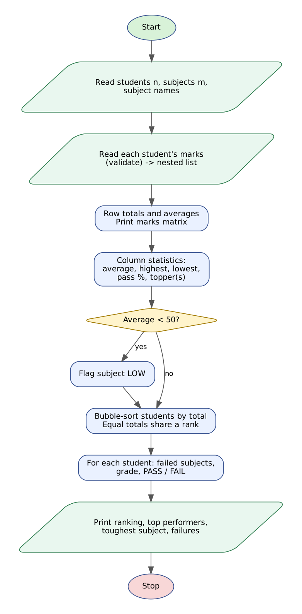

# Case Study 42: Student Marks Matrix Analysis

> Python Activity-Based Learning - case study **#42** from the given list of 100.


## 1. Problem Statement

After every examination a class teacher holds a table of marks - one row for each student and one column for each subject. Reading the table by eye is slow and error-prone. The teacher needs **row-wise results** (total, average, rank, grade, pass or fail), **column-wise statistics** (class average, highest, lowest, pass percentage and subject topper) and **highlights** such as the top performers and subjects where the class is struggling.

Write a Python program that stores the marks in a **nested list (matrix)**, analyses it in both directions and prints a complete report. Students with equal totals must share a rank.

## 2. Objectives

- Create and traverse a two-dimensional (nested) list with nested loops.
- Compute row-wise and column-wise totals, averages, maximum, minimum and pass percentage.
- Rank students with a bubble sort and shared ranks for equal totals.
- Assign grades and pass/fail results with a conditional ladder.
- Detect subjects with a low class average and list the top performers.

## 3. Assumptions

- 1-30 students and 1-8 subjects; every mark is a whole number from 0 to 100.
- Student names are single words (use `_` for two-part names); each record is `Name m1 m2 ... mk`.
- Pass mark per subject: 40. A student who fails any subject gets grade F and result FAIL.
- Grades by overall percentage: O 90+, A+ 80+, A 70+, B 60+, C 50+, D below 50.
- A subject is LOW if its class average is below 50.
- Ranking is competition style: equal totals share a rank (1, 2, 2, 4 ...). Top performers = rank 3 or better.

## 4. Algorithm

1. Read the number of students and subjects and the subject names (re-ask until valid).
2. For each student read `Name marks...`; validate; append the name to `names` and the marks to the nested list `marks`.
3. Compute every row total and print the matrix with total and average.
4. For every column compute sum, highest, lowest and number of passes; collect the name(s) of the subject topper(s).
5. Flag the subject as LOW if its average is below 50.
6. Make an index list and bubble-sort it by descending total; give equal totals the same rank.
7. For each student in rank order find the failed subjects, then the grade and result, and print the line.
8. Find the toughest and best-scoring subject from the column averages.
9. List the top performers, low-average subjects and the number of failing students.

## 5. Flowchart



*(Graphviz source: [flowchart.dot](flowchart.dot))*

## 6. Pseudocode

```text
START
  PASS <- 40; LOW_AVG <- 50
  READ n, m, subjects (m names)                         (validate)
  names <- [ ]; marks <- [ ]
  FOR i <- 1 TO n
      READ line until it has name + m marks, each 0..100
      ADD name TO names;  ADD list of marks TO marks      // marks is a nested list
  FOR i <- 1 TO n:  totals[i] <- SUM(marks[i][1..m])
  PRINT matrix with totals and averages
  FOR j <- 1 TO m
      sum, high, low, passed <- column statistics over i
      avg <- sum / n
      toppers <- names of students with marks[i][j] = high
      IF avg < LOW_AVG THEN FLAG subject LOW
      PRINT subject row
  order <- [1..n]; BUBBLE-SORT order by totals (descending)
  FOR pos <- 1 TO n
      IF totals[order[pos]] = totals[order[pos-1]] THEN rank <- same rank ELSE rank <- pos
  FOR EACH student in order
      failed <- subjects with marks < PASS
      IF failed not empty THEN grade <- "F"; result <- "FAIL in ..."
      ELSE grade from percentage ladder; result <- "PASS"
      PRINT rank, name, total, percent, grade, result
  PRINT top performers, toughest and best subject, low-average subjects, number failing
END
```

## 7. Python Source Code

File: [`marks_matrix.py`](marks_matrix.py)

```python
# =====================================================================
# CS42 : Student Marks Matrix Analysis
# Syllabus used : variables, data types, operators, conditionals,
#                 loops, strings, lists, nested lists
# =====================================================================

print("=" * 76)
print("                STUDENT MARKS MATRIX ANALYSIS")
print("=" * 76)

PASS_MARK = 40       # minimum marks to pass a subject
LOW_AVG = 50         # subject average below this is flagged LOW
TOP_RANKS = 3        # report students up to this rank

# ---------------- Matrix size ----------------
text = input("Number of students (1-30) : ")
while not text.isdigit() or int(text) < 1 or int(text) > 30:
    text = input("  Enter a number between 1 and 30 : ")
n = int(text)

text = input("Number of subjects (1-8) : ")
while not text.isdigit() or int(text) < 1 or int(text) > 8:
    text = input("  Enter a number between 1 and 8 : ")
m = int(text)

subjects = input("Subject names (space-separated) : ").split()
while len(subjects) != m:
    subjects = input("  Enter exactly " + str(m) + " names : ").split()

# ---------------- Build the nested list (matrix) ----------------
names = []
marks = []        # nested list: marks[student][subject]
for i in range(n):
    ok = False
    while not ok:
        line = input("Student " + str(i + 1) + " (Name + " + str(m) + " marks) : ")
        parts = line.split()
        ok = False
        if len(parts) == m + 1:
            ok = True
            for t in parts[1:]:
                if not t.isdigit() or int(t) > 100:
                    ok = False
        if not ok:
            print("  Invalid record: need a name and " + str(m) + " marks between 0 and 100.")
    names.append(parts[0])
    row = []
    for t in parts[1:]:
        row.append(int(t))
    marks.append(row)

# ---------------- Row-wise statistics ----------------
totals = []
for i in range(n):
    s = 0
    for j in range(m):
        s += marks[i][j]
    totals.append(s)

# ---------------- Print the matrix ----------------
print("\nMARKS MATRIX")
print("=" * 76)
head = f"{'Student':<10}"
for j in range(m):
    head += f"{subjects[j][0:8]:>9}"
head += f"{'Total':>8}{'Avg':>8}"
print(head)
print("-" * len(head))
for i in range(n):
    line = f"{names[i]:<10}"
    for j in range(m):
        line += f"{marks[i][j]:>9}"
    line += f"{totals[i]:>8}{totals[i] / m:>8.1f}"
    print(line)
print("-" * len(head))

# ---------------- Column-wise statistics ----------------
print("\nSUBJECT-WISE ANALYSIS")
print("=" * 76)
print(f"{'Subject':<12}{'Average':>8}{'Highest':>9}{'Lowest':>8}{'Pass%':>8}  Topper(s)")
print("-" * 76)
low_subjects = []
col_avgs = []
for j in range(m):
    col_sum = 0
    high = marks[0][j]
    low = marks[0][j]
    passed = 0
    for i in range(n):
        v = marks[i][j]
        col_sum += v
        if v > high:
            high = v
        if v < low:
            low = v
        if v >= PASS_MARK:
            passed += 1
    avg = col_sum / n
    col_avgs.append(avg)
    toppers = []
    for i in range(n):
        if marks[i][j] == high:
            toppers.append(names[i])
    note = ""
    if avg < LOW_AVG:
        note = "  << LOW AVERAGE"
        low_subjects.append(subjects[j])
    print(f"{subjects[j]:<12}{avg:>8.1f}{high:>9}{low:>8}{passed * 100 / n:>8.1f}  "
          f"{', '.join(toppers)}{note}")

# ---------------- Ranking (bubble sort on totals, ties share a rank) ----------------
order = []
for i in range(n):
    order.append(i)
for a in range(n - 1):
    for b in range(n - 1 - a):
        if totals[order[b]] < totals[order[b + 1]]:
            order[b], order[b + 1] = order[b + 1], order[b]

rank = [0] * n
for pos in range(n):
    if pos > 0 and totals[order[pos]] == totals[order[pos - 1]]:
        rank[order[pos]] = rank[order[pos - 1]]
    else:
        rank[order[pos]] = pos + 1

print("\nSTUDENT RANKING AND RESULT")
print("=" * 76)
print(f"{'Rank':<6}{'Student':<10}{'Total':>7}{'Percent':>9}  {'Grade':<6}Result")
print("-" * 76)
fail_count = 0
for pos in range(n):
    i = order[pos]
    pct = totals[i] / m
    failed = []
    for j in range(m):
        if marks[i][j] < PASS_MARK:
            failed.append(subjects[j])
    if len(failed) > 0:
        grade = "F"
        result = "FAIL in " + ", ".join(failed)
        fail_count += 1
    else:
        if pct >= 90:
            grade = "O"
        elif pct >= 80:
            grade = "A+"
        elif pct >= 70:
            grade = "A"
        elif pct >= 60:
            grade = "B"
        elif pct >= 50:
            grade = "C"
        else:
            grade = "D"
        result = "PASS"
    print(f"{rank[i]:<6}{names[i]:<10}{totals[i]:>7}{pct:>9.1f}  {grade:<6}{result}")

# ---------------- Highlights ----------------
print("\nHIGHLIGHTS")
print("=" * 76)
top_names = []
for pos in range(n):
    i = order[pos]
    if rank[i] <= TOP_RANKS:
        top_names.append(names[i] + " (rank " + str(rank[i]) + ")")
print("Top performers       : " + ", ".join(top_names))

hard = 0
easy = 0
for j in range(m):
    if col_avgs[j] < col_avgs[hard]:
        hard = j
    if col_avgs[j] > col_avgs[easy]:
        easy = j
print("Toughest subject     : " + subjects[hard] + " (average " + f"{col_avgs[hard]:.1f}" + ")")
print("Best-scoring subject : " + subjects[easy] + " (average " + f"{col_avgs[easy]:.1f}" + ")")
if len(low_subjects) == 0:
    print("Low-average subjects : None (all averages are " + str(LOW_AVG) + " or more)")
else:
    print("Low-average subjects : " + ", ".join(low_subjects))
print("Students failing     : " + str(fail_count) + " of " + str(n))
```

**How to run**

```bash
# interactive - type the inputs yourself
python marks_matrix.py

# or replay a prepared test (Linux/macOS)
python marks_matrix.py < tests/test1_input.txt

# Windows PowerShell
Get-Content tests\test1_input.txt | python marks_matrix.py
```

## 8. Test Cases

Every test has an input file (`tests/testN_input.txt`) and the program's real output (`tests/testN_output.txt`). The expected results below were checked against the output.

| # | Scenario | Key expected results (checked automatically) | Input | Result |
|---|----------|-----------------------------------------------|-------|--------|
| T1 | **Six students, five subjects, tied ranks and one failure**<br>Anil and Farah have identical marks and share rank 2; Charan fails Physics. | `Top performers       : Divya (rank 1), Anil (rank 2), Farah (rank 2)`<br>`FAIL in Physics`<br>`Students failing     : 1 of 6`<br>`Low-average subjects : None`<br>`Toughest subject     : Chem (average 69.5)`<br>+ 1 more checks | [test1_input.txt](tests/test1_input.txt) | PASS |
| T2 | **A subject with a low class average**<br>Maths average is 37 so it is flagged; 40 marks passes (boundary) while 35 and 28 fail. | `Low-average subjects : Math`<br>`<< LOW AVERAGE`<br>`Students failing     : 2 of 4`<br>`Top performers       : Lata (rank 1), Mohan (rank 2), Nisha (rank 3)`<br>`50.0` | [test2_input.txt](tests/test2_input.txt) | PASS |
| T3 | **Invalid subject list and invalid student records are re-asked**<br>Wrong number of subject names, mark 105, missing mark and a non-numeric mark are rejected. | `Enter exactly 2 names`<br>`Invalid record`<br>`Top performers       : Ravi (rank 1), Sita (rank 2)` | [test3_input.txt](tests/test3_input.txt) | PASS |

<details><summary>Input typed in test T1</summary>

```text
6
5
Maths Physics Chem English CS
Anil 92 88 76 81 95
Bhavna 67 72 58 80 70
Charan 45 38 52 60 41
Divya 88 91 94 85 90
Eswar 55 49 61 47 52
Farah 92 88 76 81 95
```
</details>

<details><summary>Input typed in test T2</summary>

```text
4
3
Math Science English
Kiran 35 70 66
Lata 40 82 71
Mohan 28 65 90
Nisha 45 74 58
```
</details>

<details><summary>Input typed in test T3</summary>

```text
2
2
OnlyOne
Sub1 Sub2
Ravi 105 80
Ravi 90
Ravi 90 80
Sita 70 abc
Sita 70 60
```
</details>

## 9. Output Screenshots

Typed input is shown in green.

**T1 - Six students, five subjects, tied ranks and one failure**


**T2 - A subject with a low class average**


**T3 - Invalid subject list and invalid student records are re-asked**


## 10. Conclusion

The nested list made it easy to analyse the same data row by row and column by column, which is exactly what a teacher needs. The report correctly gave Anil and Farah the shared rank 2 (followed by rank 4), identified Charan's single failure in Physics, and flagged Mathematics as a low-average subject (37.0) in the second dataset, where 40 marks counted as a pass but 35 and 28 did not. Invalid inputs are re-asked rather than crashing the program. All three test cases passed.
